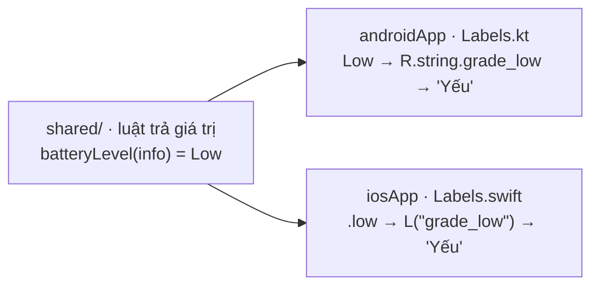

# Chuỗi và đa ngôn ngữ trên từng nền tảng

UI viết riêng thì chữ trên màn cũng đi theo từng nền tảng: Android dùng `res/values*/strings.xml`, iOS dùng
`*.lproj/Localizable.strings`. Hai bên **dùng chung một bộ key** để dễ đối chiếu. Phần chung (`shared/`) không chứa chữ
hiển thị: nó trả về *giá trị* (`BatteryLevel.Low`, `ConnectionType.Wifi`), mỗi UI tự đổi giá trị đó thành chữ.

## Mục tiêu

- Đưa mọi chữ của Dashboard ra file chuỗi, có tiếng Anh (mặc định) và tiếng Việt, trên **cả hai** app.
- Đổi enum / kết quả luật của `shared/` thành chữ + màu ở tầng UI (`ChargingState.label`, `BatteryLevel.grade`).
- Định dạng số (toạ độ, mét, ms) giống nhau trên hai nền tảng.

## Ai giữ chữ



Vì sao không để chữ trong `shared/`: luật không cần biết ngôn ngữ, test luật không phụ thuộc chữ, và mỗi nền tảng đã có
sẵn cơ chế chọn ngôn ngữ theo máy, xử lý số nhiều, dịch trong Android Studio / Xcode.

## Thư mục

=== "Android"

    ```text
    androidApp/src/main/res/
    ├── values/strings.xml       # mặc định (tiếng Anh)
    └── values-vi/strings.xml    # tiếng Việt — Android chọn theo ngôn ngữ máy
    ```

=== "iOS"

    ```text
    iosApp/iosApp/
    ├── en.lproj/Localizable.strings   # tiếng Anh
    └── vi.lproj/Localizable.strings   # tiếng Việt
    ```

    Info.plist cần khai báo ngôn ngữ app hỗ trợ, thiếu thì iOS không bao giờ chọn tiếng Việt:

    ```xml
    <key>CFBundleLocalizations</key>
    <array><string>en</string><string>vi</string></array>
    ```

## Cùng key, hai định dạng

=== "strings.xml (values-vi)"

    ```xml
    <resources>
        <string name="app_name">Device Pulse</string>
        <string name="sensor_battery">Pin</string>
        <string name="sensor_location">Vị trí</string>
        <string name="sensor_network">Mạng</string>
        <string name="charging_charging">Đang sạc</string>
        <string name="charging_discharging">Đang dùng pin</string>
        <string name="state_loading">Đang đọc…</string>
        <string name="state_permission_denied">Chưa được cấp quyền</string>
        <string name="state_unsupported">Máy này không hỗ trợ</string>
        <string name="state_error">Lỗi: %1$s</string>
        <string name="grade_low">Yếu</string>
    </resources>
    ```

=== "Localizable.strings (vi.lproj)"

    ```text
    /* Cùng key với androidApp/src/main/res/values-vi/strings.xml. Sửa bên này nhớ sửa bên kia. */
    "app_name" = "Device Pulse";
    "sensor_battery" = "Pin";
    "sensor_location" = "Vị trí";
    "sensor_network" = "Mạng";
    "charging_charging" = "Đang sạc";
    "charging_discharging" = "Đang dùng pin";
    "state_loading" = "Đang đọc…";
    "state_permission_denied" = "Chưa được cấp quyền";
    "state_unsupported" = "Máy này không hỗ trợ";
    "state_error" = "Lỗi: %@";
    "grade_low" = "Yếu";
    ```

Khác nhau đáng nhớ: tham số chuỗi Android là `%1$s`, iOS là `%@`; chuỗi thiếu ở `values-vi` thì Android lấy từ `values`,
iOS lấy từ ngôn ngữ phát triển (`CFBundleDevelopmentRegion`).

## Gọi chuỗi trong code

=== "Kotlin · Compose"

    ```kotlin
    Text(stringResource(R.string.sensor_battery))
    Text(stringResource(R.string.state_error, reading.message))
    ```

=== "Swift · SwiftUI"

    ```swift
    // iosApp/iosApp/Views/Labels.swift — một hàm ngắn cho cả app
    func L(_ key: String) -> String { NSLocalizedString(key, comment: "") }
    func L(_ key: String, _ arg: String) -> String { String(format: L(key), arg) }

    Text(L("sensor_battery"))
    Text(L("state_error", error.message))
    ```

## Đổi giá trị của `shared/` thành chữ + màu

Mỗi UI có một file `Labels` dịch enum và kết quả luật. Cùng tên hàm, cùng bảng ánh xạ:

=== "Kotlin · Labels.kt"

    ```kotlin
    enum class Tone { Good, Warn, Bad }
    data class Grade(@StringRes val label: Int, val tone: Tone)

    fun BatteryLevel.grade() = when (this) {                 // BatteryLevel đến từ shared/rules
        BatteryLevel.Critical -> Grade(R.string.grade_critical, Tone.Bad)
        BatteryLevel.Low -> Grade(R.string.grade_low, Tone.Warn)
        BatteryLevel.Ok -> Grade(R.string.grade_ok, Tone.Good)
    }

    @Composable
    fun ChargingState.label(): String = stringResource(
        when (this) {
            ChargingState.Charging -> R.string.charging_charging
            ChargingState.Discharging -> R.string.charging_discharging
            ChargingState.Full -> R.string.charging_full
            ChargingState.Unknown -> R.string.charging_unknown
        }
    )
    ```

=== "Swift · Labels.swift"

    ```swift
    enum Tone { case good, warn, bad }
    struct Grade { let label: String; let tone: Tone }

    extension BatteryLevel {                                   // enum Kotlin, SKIE cho switch được
        var grade: Grade {
            switch self {
            case .critical: Grade(label: L("grade_critical"), tone: .bad)
            case .low: Grade(label: L("grade_low"), tone: .warn)
            case .ok: Grade(label: L("grade_ok"), tone: .good)
            }
        }
    }

    extension ChargingState {
        var label: String {
            switch self {
            case .charging: L("charging_charging")
            case .discharging: L("charging_discharging")
            case .full: L("charging_full")
            case .unknown: L("charging_unknown")
            }
        }
    }
    ```

Luật **chạy ở `shared/`** (`batteryLevel(info)`), UI chỉ đổi kết quả thành chữ. `SensorCard` của bài 6 thêm tham số
`grade: Grade?` và vẽ một chip nhỏ (`GradeChip`) ở góc phải; thẻ Pin giờ có chip mức pin:

=== "Kotlin"

    ```kotlin
    SensorCard("🔋", stringResource(R.string.sensor_battery), onClick, grade = info?.let { batteryLevel(it).grade() }) {
        ReadingContent(state.battery) { Text("${it.levelPercent}% · ${it.charging.label()}") }
    }
    ```

=== "Swift"

    ```swift
    let info = (state.battery as? ReadingAvailable<BatteryInfo>)?.value
    SensorCard(emoji: "🔋", title: L("sensor_battery"), grade: info.map { batteryLevel(info: $0).grade }, onTap: onTap) {
        ReadingView(reading: state.battery) { Text("\($0.levelPercent)% · \($0.charging.label)") }
    }
    ```

## Định dạng số

Toạ độ phải hiện `10.77654` ở mọi ngôn ngữ (tiếng Việt mặc định dùng dấu phẩy thập phân). Khoá locale cố định:

| | Kotlin (androidApp) | Swift (iosApp) |
|---|---|---|
| Hàm | `fun Double.fixed(d: Int) = String.format(Locale.ROOT, "%.${d}f", this)` | `String(format: "%.\(d)f", locale: Locale(identifier: "en_US_POSIX"), self)` |
| Dùng | `fix.latitude.fixed(5)` | `fix.latitude.fixed(5)` |

Có thể đưa `fixed()` vào `shared/` (tự làm tròn vì `commonMain` không có `String.format`), nhưng định dạng là việc của
tầng hiển thị nên code mẫu để mỗi UI tự lo.

## Làm trên Device Pulse

1. Android: tạo `values/strings.xml` + `values-vi/strings.xml`, file `Labels.kt`, `Format.kt`; thay mọi chữ cứng bằng `stringResource`.
2. iOS: *File → New → String File* tên `Localizable`, bấm *Localize…* thêm `vi`; tạo `Labels.swift`; thay chữ cứng bằng `L("…")`.
3. Giữ hai file chuỗi **cùng key**: thêm key bên này thì thêm luôn bên kia.

## Kiểm tra

- [ ] Không còn chuỗi chữ cứng trong `DashboardScreen.kt` / `Components.kt` và `DashboardView.swift` / `Components.swift`.
- [ ] Android: đổi ngôn ngữ máy sang Tiếng Việt → thẻ hiện "Pin · Đang sạc"; về English → "Battery · Charging".
- [ ] iOS: Settings → General → Language & Region thêm Tiếng Việt lên đầu → app đổi chữ theo (Simulator cũng được).
- [ ] Pin 15% → chip "Yếu" màu cam trên **cả hai** app (luật từ `shared/`, chữ từ từng bên).
- [ ] Toạ độ vẫn dùng dấu chấm khi máy để tiếng Việt.

## Lỗi hay gặp { #loi-hay-gap }

- iOS hiện nguyên key (`sensor_battery`) → file `Localizable.strings` chưa nằm trong target, hoặc thiếu dấu `;` cuối dòng
  (một dòng sai là cả file hỏng).
- iOS không ra tiếng Việt → thiếu `vi` trong `CFBundleLocalizations` hoặc trong *Project → Info → Localizations*.
- Android báo `Unresolved reference: R` trong file mới → import `dev.devicepulse.android.R`.
- Hai bên lệch chữ → so key bằng `grep`, hoặc viết một script nhỏ so hai file. Xem thêm [xử lý sự cố](../reference/troubleshooting.md).

## Tiếp theo?

- [Bài 8: state chung và điều hướng native](08-viewmodel-navigation.md).
- Đọc thêm: [String Catalog của Xcode (`.xcstrings`)](https://developer.apple.com/documentation/xcode/localizing-and-varying-text-with-a-string-catalog) — cách mới thay `Localizable.strings` · [Per-app language trên Android](https://developer.android.com/guide/topics/resources/app-languages).

## Docs gốc

[Localize your app (Android)](https://developer.android.com/guide/topics/resources/localization) · [String resources](https://developer.android.com/guide/topics/resources/string-resource) · [Localization (Apple)](https://developer.apple.com/documentation/xcode/localization) · [NSLocalizedString](https://developer.apple.com/documentation/foundation/nslocalizedstring)
