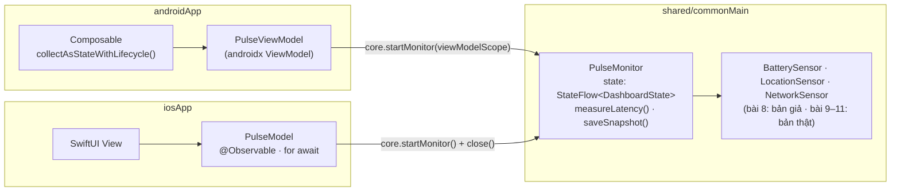

# State chung và điều hướng native

Ở bài 6–7 hai UI vẽ một `DashboardState` giả cố định. Bài này đưa phần **giữ state** vào `shared/`: một class
`PulseMonitor` gộp 3 cảm biến (đang là bản giả, cắm qua Koin) thành một `StateFlow<DashboardState>`. Mỗi app chỉ bọc
nó một lớp mỏng theo kiểu của nền tảng mình, rồi thêm màn Chi tiết và Lịch sử bằng điều hướng **native**.

## Mục tiêu

- `PulseMonitor` trong `commonMain` giữ toàn bộ state + action; hai UI **không** tự gộp cảm biến hay gọi database.
- Android bọc bằng `ViewModel` (`viewModelScope`), iOS bọc bằng class `@Observable` đọc `StateFlow` qua SKIE.
- Dashboard → Chi tiết → Back, Dashboard → Lịch sử trên cả hai, mỗi bên dùng điều hướng của chính nó.



## `PulseMonitor`: "ViewModel" viết một lần

```kotlin
// shared/src/commonMain/kotlin/dev/devicepulse/core/PulseMonitor.kt
data class DashboardState(
    val battery: Reading<BatteryInfo> = Reading.Loading,
    val location: Reading<LocationFix> = Reading.Loading,
    val network: Reading<NetworkStatus> = Reading.Loading,
    val latencyMs: Reading<Long>? = null,          // bài 11
)

class PulseMonitor(
    battery: BatterySensor,
    location: LocationSensor,
    network: NetworkSensor,
    private val scope: CoroutineScope,
) {
    val state: StateFlow<DashboardState> =
        combine(battery.observe(), location.observe(), network.observe()) { b, l, n ->
            DashboardState(battery = b, location = l, network = n)
        }.stateIn(scope, SharingStarted.WhileSubscribed(5_000), DashboardState())

    fun close() = scope.cancel()
}

/** Cửa vào lõi cho cả hai app; Koin dựng một lần. */
class PulseCore(
    private val battery: BatterySensor,
    private val location: LocationSensor,
    private val network: NetworkSensor,
) {
    fun startMonitor(scope: CoroutineScope) = PulseMonitor(battery, location, network, scope)

    /** Cho Swift: Swift không tự tạo CoroutineScope được. Nhớ gọi close() khi xong. */
    fun startMonitor() = startMonitor(MainScope())
}
```

- **Không** kế thừa `androidx.lifecycle.ViewModel`: `PulseMonitor` là class Kotlin thường, chạy trên `scope` được truyền vào.
  Android đưa `viewModelScope`, iOS đưa `MainScope()` rồi tự `close()`. Nhờ vậy lõi không phụ thuộc vòng đời của nền tảng nào.
- `combine` phát lại mỗi khi **một trong ba** luồng có giá trị mới (sau khi cả ba đã phát ít nhất một lần).
- `WhileSubscribed(5_000)`: chỉ nghe cảm biến khi có UI đang thu; xoay màn hình (dưới 5 giây) không phải đăng ký lại.
- Hàm không bắt đầu bằng `new…`: Objective-C coi `new` là từ khoá, Swift sẽ thấy `doNewMonitor()`.

Bài 11 thêm `LatencyProbe` + `measureLatency()`, bài 12 thêm `HistoryRepository` + `saveSnapshot()` vào đúng class này.

## Sensor giả và Koin

```kotlin
// shared/src/commonMain/kotlin/dev/devicepulse/sensor/FakeSensors.kt
class FakeBatterySensor(
    initial: Reading<BatteryInfo> = Reading.Available(BatteryInfo(76, ChargingState.Charging)),
) : BatterySensor {
    val readings = MutableStateFlow(initial)
    override fun observe(): Flow<Reading<BatteryInfo>> = readings
}
// FakeLocationSensor (mặc định PermissionDenied), FakeNetworkSensor (Wifi · online) viết y hệt
```

```kotlin
// shared/src/commonMain/kotlin/dev/devicepulse/di/Koin.kt
val commonModule = module {
    single<BatterySensor> { FakeBatterySensor() }
    single<LocationSensor> { FakeLocationSensor() }
    single<NetworkSensor> { FakeNetworkSensor() }
    single { PulseCore(get(), get(), get()) }
}

// shared/src/iosMain/kotlin/dev/devicepulse/di/KoinIos.kt
/** Swift không gọi được get<T>() của Koin (reified), nên iOS lấy lõi qua hàm này. */
fun pulseCore(): PulseCore = KoinPlatform.getKoin().get()
```

`initKoin` và chỗ gọi nó (`DevicePulseApp` / `iOSApp.swift`) có từ [bài 5](05-dependencies.md). Bài 9 bắt đầu thay
bản giả bằng bản thật trong `platformModule`.

## Bọc mỏng ở mỗi app

=== "Android · PulseViewModel"

    ```kotlin
    // androidApp/.../ui/PulseViewModel.kt
    class PulseViewModel(core: PulseCore) : ViewModel() {
        val monitor = core.startMonitor(viewModelScope)   // xoay màn: ViewModel sống tiếp → state giữ nguyên
    }

    // androidApp/.../DevicePulseApp.kt
    val appModule = module { viewModelOf(::PulseViewModel) }
    // initKoin { androidContext(this@DevicePulseApp); modules(appModule) }
    ```

    Trong Compose:

    ```kotlin
    val viewModel: PulseViewModel = koinViewModel()
    val state by viewModel.monitor.state.collectAsStateWithLifecycle()
    ```

    `collectAsStateWithLifecycle` **ngừng thu** khi app xuống nền; kết hợp `WhileSubscribed`, cảm biến thật (bài 9+) cũng được huỷ đăng ký, đỡ tốn pin.

=== "iOS · PulseModel"

    ```swift
    // iosApp/iosApp/PulseModel.swift
    import Observation
    import Shared

    @MainActor @Observable
    final class PulseModel {
        private(set) var state: DashboardState
        private let monitor: PulseMonitor

        init(core: PulseCore) {
            let monitor = core.startMonitor()
            self.monitor = monitor
            self.state = monitor.state.value
            // SKIE: StateFlow → AsyncSequence. Còn thu là cảm biến còn chạy.
            Task { [weak self] in
                for await state in monitor.state { self?.state = state }
            }
        }

        func measureLatency() { monitor.measureLatency() }   // bài 11: action chỉ chuyển tiếp xuống lõi
        // Model này sống suốt đời app nên không cần close(). Model gắn với MỘT màn hình thì gọi monitor.close() khi màn đóng.
    }
    ```

    ```swift
    // iosApp/iosApp/iOSApp.swift
    @main
    struct iOSApp: App {
        @State private var model: PulseModel

        init() {
            doInitKoin()                                       // cùng module Koin với Android
            _model = State(initialValue: PulseModel(core: pulseCore()))
        }

        var body: some Scene { WindowGroup { RootView(model: model) } }
    }
    ```

    SwiftUI tự vẽ lại khi `state` của class `@Observable` đổi. `[weak self]` để `Task` không giữ model sống mãi.

## Điều hướng native

Route và màn hình là việc của UI, nên mỗi bên dùng bộ điều hướng của mình. `SensorKind` (enum ở `shared/`) dùng chung
làm tham số:

=== "Android · Navigation Compose"

    ```kotlin
    // androidApp/.../ui/App.kt
    @Composable
    fun App() = MaterialTheme {
        val viewModel: PulseViewModel = koinViewModel()        // một ViewModel cho cả app, đặt trên NavHost
        val state by viewModel.monitor.state.collectAsStateWithLifecycle()
        val nav = rememberNavController()

        NavHost(nav, startDestination = "dashboard") {
            composable("dashboard") {
                DashboardScreen(
                    state,
                    onOpenDetail = { nav.navigate("detail/${it.name}") },
                    onOpenHistory = { nav.navigate("history") },
                )
            }
            composable("detail/{sensor}") { entry ->
                val sensor = SensorKind.valueOf(entry.arguments?.getString("sensor") ?: SensorKind.Battery.name)
                DetailScreen(sensor, state, onBack = { nav.popBackStack() })
            }
            composable("history") { PlaceholderScreen("Lịch sử — có ở bài 12", onBack = { nav.popBackStack() }) }
        }
    }
    ```

    Màn con có `TopAppBar` với `navigationIcon` gọi `onBack`; nút Back hệ thống Android tự `popBackStack`.

=== "iOS · NavigationStack"

    ```swift
    // iosApp/iosApp/Views/RootView.swift
    enum Route: Hashable {
        case detail(SensorKind)
        case history
    }

    struct RootView: View {
        let model: PulseModel
        @State private var path: [Route] = []

        var body: some View {
            NavigationStack(path: $path) {
                DashboardView(model: model, open: { path.append($0) })
                    .navigationDestination(for: Route.self) { route in
                        switch route {
                        case .detail(let sensor): DetailView(sensor: sensor, model: model)
                        case .history: Text("Lịch sử — có ở bài 12")
                        }
                    }
            }
        }
    }
    ```

    Nút Back và vuốt từ mép trái để quay lại là của iOS, không phải tự vẽ. `SensorKind` dùng được trong `Route: Hashable`
    vì Kotlin enum qua SKIE là enum Swift.

`DashboardScreen` / `DashboardView` giờ nhận `model` (hoặc `state` + các lambda) thay cho state giả của bài 6;
`fakeDashboardState()` chỉ còn dùng cho Preview.

## Làm trên Device Pulse

1. `shared/`: `PulseMonitor.kt` (dời `DashboardState` vào đây), `PulseCore`, `FakeSensors.kt`; điền `commonModule`; thêm `KoinIos.kt`.
2. `androidApp/`: thêm `lifecycle-viewmodel-compose`, `lifecycle-runtime-compose`, `navigation-compose`, `koin-compose-viewmodel`;
   viết `PulseViewModel`, `App()` với `NavHost`, `DetailScreen`, `PlaceholderScreen`.
3. `iosApp/`: `PulseModel.swift`, `RootView.swift`, `DetailView.swift`; sửa `iOSApp.swift`.

## Kiểm tra

- [ ] Hai app hiện 3 thẻ từ **sensor giả** (Vị trí hiện "Chưa được cấp quyền").
- [ ] Android: xoay màn hình → state giữ nguyên, các thẻ không quay lại Loading.
- [ ] Bấm thẻ Pin → màn Chi tiết; Back (nút trên thanh, nút hệ thống Android, vuốt mép trái iOS) đều quay lại.
- [ ] Đổi giá trị mặc định của `FakeBatterySensor` trong `shared/` → **cả hai** app đổi theo, không sửa dòng UI nào.

## Lỗi hay gặp

- iOS: `KoinApplication has not been started` → `doInitKoin()` phải chạy **trước** `pulseCore()` (trong `init()` của `iOSApp`).
- iOS: UI không đổi khi state đổi → quên `@Observable`, hoặc gán `state` ngoài main actor (thiếu `@MainActor`).
- iOS: cảm biến chạy mãi sau khi rời một màn có `PulseMonitor` riêng → quên `close()`; Android không gặp vì `viewModelScope` tự huỷ.
- Android: `No definition found for PulseViewModel` → chưa nạp `appModule` trong `initKoin`. Xem thêm [xử lý sự cố](../reference/troubleshooting.md).

## Tiếp theo?

- [Bài 9: đọc pin thật trên Android và iOS](09-battery.md).
- Đọc thêm: [SKIE: Flows](https://skie.touchlab.co/features/flows) · [Observation trong SwiftUI](https://developer.apple.com/documentation/observation) · [Koin cho Android](https://insert-koin.io/docs/reference/koin-android/viewmodel/).

## Docs gốc

[StateFlow và stateIn](https://developer.android.com/kotlin/flow/stateflow-and-sharedflow) · [ViewModel (Android)](https://developer.android.com/topic/libraries/architecture/viewmodel) · [Navigation Compose](https://developer.android.com/develop/ui/compose/navigation) · [NavigationStack](https://developer.apple.com/documentation/swiftui/navigationstack) · [Share more logic between iOS and Android](https://kotlinlang.org/docs/multiplatform/multiplatform-upgrade-app.html)
