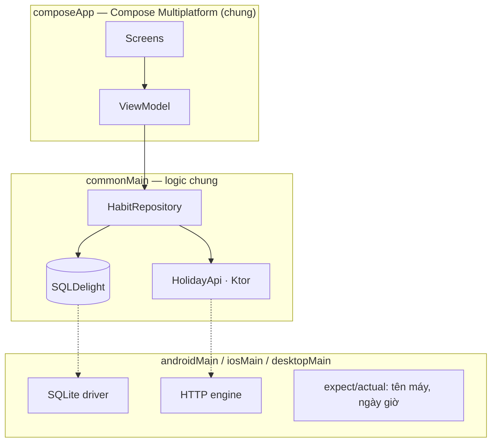

# App MVP: Habit Tick

Mọi bài trong lộ trình đều ráp vào **một** app, để bạn thấy các mảnh KMP nối với nhau thế nào trong một sản phẩm thật,
thay vì làm bài tập rời rạc.

## Habit Tick làm gì

Một app đánh dấu thói quen mỗi ngày:

- Thêm thói quen ("Đọc 10 trang", "Chạy bộ").
- Mỗi ngày bấm ✓ khi làm xong; xem chuỗi ngày liên tiếp (streak).
- Lưu offline trên máy.
- Hiện ngày lễ sắp tới của quốc gia đã chọn (lấy từ API công khai, không cần key) để nhắc "mai nghỉ lễ, đừng đứt chuỗi".

## Phạm vi MVP

| Có | Không làm ở MVP |
|---|---|
| Danh sách thói quen, thêm / xoá | Đăng nhập, đồng bộ đám mây |
| Tick hôm nay, tính streak | Thống kê biểu đồ |
| Màn chi tiết một thói quen | Widget, Apple Watch |
| Lưu offline (SQLDelight) | Thông báo nhắc giờ |
| Ngày lễ sắp tới (Ktor + API công khai) | Thanh toán, subscription |
| Tiếng Việt + tiếng Anh | Giao diện web |
| Android, iOS, Desktop | |

Thứ ngoài phạm vi thì ghi lại, làm sau khi MVP chạy đủ 3 nền tảng.

## Kiến trúc



- **UI** viết một lần bằng Compose Multiplatform.
- **Logic + dữ liệu** nằm hết ở `commonMain`.
- Chỉ phần **driver** (SQLite, HTTP engine) và vài API của máy là khác nhau theo nền tảng.

## Cấu trúc thư mục cuối cùng

```text
habit-tick/
├── composeApp/
│   └── src/
│       ├── commonMain/kotlin/…   # UI, ViewModel, Repository, model
│       ├── commonMain/sqldelight/…  # file .sq
│       ├── commonMain/composeResources/  # strings, ảnh
│       ├── androidMain/…          # MainActivity, driver Android
│       ├── iosMain/…              # MainViewController, driver iOS
│       ├── desktopMain/…          # main(), driver JVM
│       └── commonTest/…           # test chung
├── iosApp/                        # project Xcode bọc app
└── gradle/libs.versions.toml      # phiên bản thư viện
```

## Tiếp theo?

- Xem [checklist hoàn thành](checklist.md) để biết "xong" nghĩa là gì.
- Bắt đầu [bài 1](../lessons/01-what-is-kmp.md).
