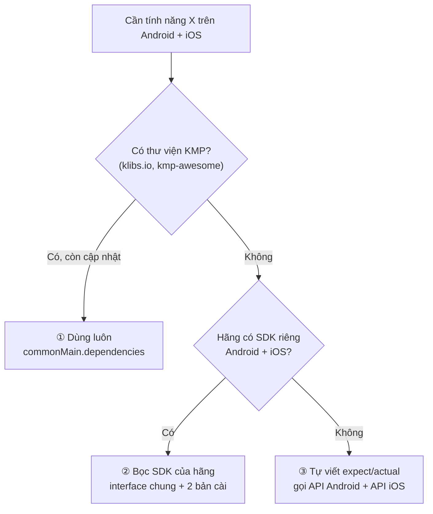
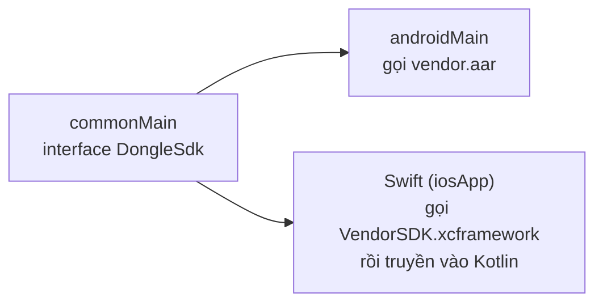

# Android làm được gì với KMP

Ba câu hỏi hay gặp nhất khi đưa một tính năng Android vào KMP:

1. Tính năng này (BLE, camera, thông báo, mua gói…) **có ai làm sẵn SDK/thư viện KMP chưa**?
2. Chưa có thì **tự viết, tự build, tự cài** vào app được không?
3. Thư viện KMP **free** nào lấy về dùng được ngay, dùng cả cho app bán tiền?

Trang này trả lời cả ba. Mọi thư viện đều đã kiểm trên GitHub ngày **16/10/2026**: còn cập nhật, không archive, đọc license.

!!! info "Kết luận ngắn"
    - **Có sẵn và đủ tốt** cho phần lớn việc của app thường: mạng, lưu dữ liệu, BLE, vị trí, quyền, file, camera, quét mã,
      thông báo, mua gói, log, crash, Firebase.
    - **Phải tự viết** (vài chục dòng `expect`/`actual`) cho phần phần cứng ít người dùng: NFC, cảm biến chuyển động, chạy ngầm,
      in-app review. Thư viện có nhưng quá nhỏ, chưa nên tin.
    - **Tự build SDK KMP** của mình được, và cài vào app khác được: `publishToMavenLocal` ở máy, GitHub Packages cho team,
      Maven Central cho công khai, XCFramework / Swift Package cho app iOS native.
    - Gần như toàn bộ thư viện dưới đây là **Apache-2.0 hoặc MIT**: dùng cho app thương mại, đóng mã được. Tránh **GPL**.

## Ba cách có một tính năng trong KMP



| Cách | Khi nào | Công sức |
|---|---|---|
| **① Dùng thư viện KMP có sẵn** | Việc phổ biến: mạng, DB, BLE, quyền… | Thêm 1 dòng Gradle |
| **② Bọc SDK hãng** | Hãng phần cứng/dịch vụ chỉ phát hành `.aar` cho Android và `.xcframework`/SPM cho iOS | 1 interface + 2 bản cài, nửa ngày |
| **③ Tự viết `expect`/`actual`** | API hệ điều hành chưa ai bọc: NFC, cảm biến, review | Vài chục dòng mỗi nền tảng |

Device Pulse dùng cả ba: Ktor/SQLDelight là ①, đọc pin/GPS tự viết là ③ ([bài 9](../lessons/09-battery.md), [bài 10](../lessons/10-location.md)).

## ① Thư viện KMP free dùng được ngay

Cột **UI** quan trọng: thư viện ghi **Compose** chỉ dùng được khi UI viết bằng Compose Multiplatform. Đi đường UI native
(Jetpack Compose + **SwiftUI**) thì trên iOS chỉ dùng được thư viện **Logic**.

### Chính chủ (JetBrains, Google)

| Việc | Thư viện | UI | License |
|---|---|---|---|
| Coroutine, Flow | [kotlinx.coroutines](https://github.com/Kotlin/kotlinx.coroutines) | Logic | Apache-2.0 |
| JSON | [kotlinx.serialization](https://github.com/Kotlin/kotlinx.serialization) | Logic | Apache-2.0 |
| Ngày giờ | [kotlinx-datetime](https://github.com/Kotlin/kotlinx-datetime) | Logic | Apache-2.0 |
| Đọc ghi file, byte | [kotlinx-io](https://github.com/Kotlin/kotlinx-io) · [Okio](https://github.com/square/okio) | Logic | Apache-2.0 |
| Gọi API | [Ktor client](https://github.com/ktorio/ktor) | Logic | Apache-2.0 |
| Jetpack KMP: **Room**, **DataStore**, **ViewModel**, Lifecycle, Paging, SQLite | [androidx](https://developer.android.com/kotlin/multiplatform) · [mẫu của Google](https://github.com/android/kotlin-multiplatform-samples) | Logic | Apache-2.0 |
| UI chung | [Compose Multiplatform](https://github.com/JetBrains/compose-multiplatform) | Compose | Apache-2.0 |

### Phần cứng và API máy

| Việc của Android | Thư viện KMP | UI | Cập nhật | License | Ghi chú |
|---|---|---|---|---|---|
| **Bluetooth LE** | [JuulLabs/kable](https://github.com/JuulLabs/kable) | Logic | 10/2026 | Apache-2.0 | Lựa chọn số 1, dùng ở [OBD Link](../apps/05-obd-link.md). Không có Bluetooth Classic (iOS cũng không cho) |
| Bluetooth LE (dự phòng) | [Reedyuk/blue-falcon](https://github.com/Reedyuk/blue-falcon) | Logic | 10/2026 | Apache-2.0 | Thêm macOS, Windows, JS |
| Xin quyền | [brewkits/Grant](https://github.com/brewkits/Grant) · [Calf](https://github.com/MohamedRejeb/Calf) | Logic / Compose | 10/2026 | Apache-2.0 | [moko-permissions](https://github.com/icerockdev/moko-permissions) phổ biến nhưng ngừng cập nhật từ 08/2025 |
| Vị trí, geocoding | [jordond/compass](https://github.com/jordond/compass) | Logic | 10/2026 | MIT | Thay `LocationSensor` tự viết ở bài 10 |
| Trạng thái mạng | [jordond/connectivity](https://github.com/jordond/connectivity) | Logic | 10/2026 | MIT | Online/offline, Wi-Fi hay di động |
| Camera | [Kashif-E/Kamera](https://github.com/Kashif-E/Kamera) | Compose | 09/2026 | Apache-2.0 | Chụp ảnh, preview |
| Quét QR / barcode | [ismai117/KScan](https://github.com/ismai117/KScan) | Compose | 09/2026 | Apache-2.0 | ML Kit trên Android, AVFoundation trên iOS |
| Tạo mã QR | [alexzhirkevich/qrose](https://github.com/alexzhirkevich/qrose) | Compose | 10/2026 | MIT | |
| Chọn / lưu file, ảnh | [vinceglb/FileKit](https://github.com/vinceglb/FileKit) | Logic + Compose | 10/2026 | MIT | Có bản core không cần Compose |
| Thông báo đẩy + local | [mirzemehdi/KMPNotifier](https://github.com/mirzemehdi/KMPNotifier) | Logic | 08/2026 | Apache-2.0 | FCM trên cả hai nền tảng |
| Hẹn giờ thông báo | [Tweener/alarmee](https://github.com/Tweener/alarmee) | Logic | 09/2026 | Apache-2.0 | Nhắc lặp lại theo lịch |
| Sức khoẻ | [KHealth](https://github.com/shubhamsinghshubham777/KHealth) · [HealthKMP](https://github.com/vitoksmile/HealthKMP) | Logic | 09/2026 | Apache-2.0 | Health Connect ↔ HealthKit |
| Vân tay / Face ID | [moko-biometry](https://github.com/icerockdev/moko-biometry) | Logic | 02/2025 | Apache-2.0 | Ít cập nhật, thử trước khi dùng. Tự viết cũng ngắn |
| WebView | [compose-webview-multiplatform](https://github.com/KevinnZou/compose-webview-multiplatform) | Compose | 12/2025 | Apache-2.0 | |
| Bản đồ | [software-mansion/kmp-maps](https://github.com/software-mansion/kmp-maps) | Compose | 06/2026 | MIT | Google Maps ↔ Apple Maps |

### Dịch vụ, có SDK KMP chính hãng hoặc gần chính hãng

| Việc | Thư viện | License | Ghi chú |
|---|---|---|---|
| **Mua gói / subscription** | [RevenueCat/purchases-kmp](https://github.com/RevenueCat/purchases-kmp) | MIT | **Chính hãng**. SDK free; dịch vụ tính phí khi doanh thu vượt mức free, xem trang giá RevenueCat |
| Firebase (Auth, Firestore, Analytics…) | [GitLiveApp/firebase-kotlin-sdk](https://github.com/GitLiveApp/firebase-kotlin-sdk) | Apache-2.0 | Do GitLive làm, không phải Google, nhưng rất phổ biến |
| Backend có sẵn (DB, auth, storage) | [supabase-kt](https://github.com/supabase-community/supabase-kt) | MIT | |
| Crash report | [Sentry KMP](https://github.com/getsentry/sentry-kotlin-multiplatform) · [CrashKiOS](https://github.com/touchlab/CrashKiOS) | MIT · Apache-2.0 | CrashKiOS gửi crash iOS sang Crashlytics/Bugsnag |
| Giám sát app | [Datadog KMP](https://github.com/DataDog/dd-sdk-kotlin-multiplatform) | Apache-2.0 | Chính hãng |
| GraphQL | [apollo-kotlin](https://github.com/apollographql/apollo-kotlin) | MIT | |
| Đăng nhập Google/Apple | [mirzemehdi/KMPAuth](https://github.com/mirzemehdi/KMPAuth) | Apache-2.0 | |
| Quảng cáo AdMob | [LexiLabs-App/basic-ads](https://github.com/LexiLabs-App/basic-ads) | MIT | Cộng đồng, nhỏ. Thử kỹ trước khi ship |

### Hạ tầng app

| Việc | Thư viện | License |
|---|---|---|
| DI | [Koin](https://github.com/InsertKoinIO/koin) · [kotlin-inject](https://github.com/evant/kotlin-inject) | Apache-2.0 |
| SQL | [SQLDelight](https://github.com/sqldelight/sqldelight) · Room (ở trên) | Apache-2.0 |
| Lưu key–value | [multiplatform-settings](https://github.com/russhwolf/multiplatform-settings) · DataStore | Apache-2.0 |
| Cache dữ liệu mạng | [Store](https://github.com/MobileNativeFoundation/Store) | Apache-2.0 |
| Gọi REST kiểu Retrofit | [Ktorfit](https://github.com/Foso/Ktorfit) | Apache-2.0 |
| Ảnh từ mạng | [Coil 3](https://github.com/coil-kt/coil) · [Landscapist](https://github.com/skydoves/landscapist) | Apache-2.0 |
| Log | [Kermit](https://github.com/touchlab/Kermit) · [Napier](https://github.com/AAkira/Napier) | Apache-2.0 |
| Mã hoá | [cryptography-kotlin](https://github.com/whyoleg/cryptography-kotlin) | Apache-2.0 |
| State machine | [KStateMachine](https://github.com/KStateMachine/kstatemachine) | BSL-1.0 (Boost, dễ dãi như MIT) |
| Animation Lottie | [compottie](https://github.com/alexzhirkevich/compottie) | MIT |
| Điều hướng | [Decompose](https://github.com/arkivanov/Decompose) · [Voyager](https://github.com/adrielcafe/voyager) | Apache-2.0 · MIT |
| Dùng từ Swift cho dễ | [SKIE](https://github.com/touchlab/SKIE) · [KMP-NativeCoroutines](https://github.com/rickclephas/KMP-NativeCoroutines) | Apache-2.0 · MIT |

!!! warning "Đừng chọn"
    - **Realm Kotlin**: MongoDB đã ngừng phát triển Atlas Device SDKs. Dùng Room hoặc SQLDelight.
    - **peekaboo**, **KVault**: không cập nhật từ 2024.
    - Thư viện **GPL-3.0** (vd `meshtastic-sdk`, `kotlin-usb-client-library`): bắt app phải mở mã. Chỉ dùng khi app cũng mã nguồn mở.

## Việc chưa có thư viện tốt → tự viết

Có repo trên GitHub nhưng ít sao, ít người dùng. Tự viết bằng `expect`/`actual` an toàn hơn và cũng chỉ vài chục dòng.

| Việc | Android (`androidMain`) | iOS (`iosMain`) | Có repo tham khảo |
|---|---|---|---|
| NFC đọc thẻ | `NfcAdapter` + `IntentFilter` | `CoreNFC` (`NFCNDEFReaderSession`) | [NfcReaderKMP](https://github.com/dalafiarisamuel/NfcReaderKMP) (8★) |
| Cảm biến gia tốc, la bàn | `SensorManager` | `CoreMotion` (`CMMotionManager`) | Chưa có repo đáng dùng |
| Chạy ngầm định kỳ | `WorkManager` | `BGTaskScheduler` | [meeseeks](https://github.com/matt-ramotar/meeseeks) (132★) |
| Xin đánh giá app | Play In-App Review | `SKStoreReviewController` / `requestReview` | Vài repo dưới 10★ |
| Rung | `Vibrator` | `UIImpactFeedbackGenerator` | |
| USB serial | [usb-serial-for-android](https://github.com/mik3y/usb-serial-for-android) (MIT) | **Không có**: iOS không cho app nói chuyện USB serial tự do | Chỉ làm ở `androidMain` |

Khung chung (giống cách [bài 9](../lessons/09-battery.md) đọc pin):

```kotlin
// commonMain — app chỉ biết interface này
interface Haptics { fun tap() }

// androidMain
class AndroidHaptics(private val context: Context) : Haptics {
    override fun tap() {
        val v = context.getSystemService(Vibrator::class.java)
        v.vibrate(VibrationEffect.createOneShot(30, VibrationEffect.DEFAULT_AMPLITUDE))
    }
}

// iosMain
class IosHaptics : Haptics {
    override fun tap() = UIImpactFeedbackGenerator(UIImpactFeedbackStyle.UIImpactFeedbackStyleLight).impactOccurred()
}
```

Koin `platformModule` chọn bản cài đúng nền tảng, `commonMain` không đổi một dòng.

## ② Bọc SDK của hãng (vd dongle, máy in, thanh toán)

Hãng phần cứng thường đưa **2 SDK riêng**: `.aar` cho Android, `.xcframework` hoặc Swift Package cho iOS. KMP dùng được cả hai:



- **Android**: thêm SDK vào `androidMain.dependencies { implementation(files("libs/vendor.aar")) }` hoặc toạ độ Maven của hãng, rồi gọi thẳng từ Kotlin.
- **iOS, cách dễ nhất**: khai báo `interface DongleSdk` ở `commonMain`, **viết bản cài bằng Swift** trong `iosApp`, rồi truyền vào Kotlin lúc khởi động
  (`startKoin { modules(module { single<DongleSdk> { swiftImpl } }) }`). Chạy được với cả SDK viết bằng **Swift thuần**.
- **iOS, cách gọi thẳng từ Kotlin**: `cinterop` (hoặc plugin CocoaPods / SPM của Kotlin) nhập SDK vào `iosMain`. Chỉ thấy được API **Objective-C**;
  API chỉ có trong Swift thì Kotlin không gọi được, quay lại cách trên.

## ③ Tự build SDK KMP của mình và cài vào app khác

**Được.** Một SDK KMP chỉ là một module Gradle có target Android + iOS, đóng gói ra file mà app khác thêm vào như mọi thư viện.

### Bước 1: tạo module thư viện

Bắt đầu từ [Kotlin/multiplatform-library-template](https://github.com/Kotlin/multiplatform-library-template) (chính chủ), hoặc tách
một module `:sdk` ra khỏi project đang có. Giữ API công khai nhỏ: vài interface + data class, còn lại `internal`.

### Bước 2: chọn cách phát hành

| Phát hành ở đâu | Lệnh / công cụ | Ai cài được | Chi phí |
|---|---|---|---|
| **Máy mình** | `./gradlew :sdk:publishToMavenLocal` | App khác trên cùng máy, thêm `mavenLocal()` vào `repositories` | Free |
| **Cả team** (riêng tư) | `maven-publish` + [GitHub Packages](https://docs.github.com/packages/working-with-a-github-packages-registry/working-with-the-gradle-registry) | Người có token GitHub đọc được repo | Free trong hạn mức GitHub |
| **Công khai** | [vanniktech/gradle-maven-publish-plugin](https://github.com/vanniktech/gradle-maven-publish-plugin) → **Maven Central** | Ai cũng cài, như Ktor | Free, cần ký GPG + xác minh domain/namespace |
| **App iOS native** không dùng Gradle | `XCFramework` → `./gradlew :sdk:assembleXCFramework` | Kéo `.xcframework` vào Xcode | Free |
| App iOS qua **Swift Package** | [touchlab/KMMBridge](https://github.com/touchlab/KMMBridge) | Thêm package URL trong Xcode | Free |

Cấu hình XCFramework trong `sdk/build.gradle.kts`:

```kotlin
import org.jetbrains.kotlin.gradle.plugin.mpp.apple.XCFramework

kotlin {
    val xcf = XCFramework("DongleSdk")
    listOf(iosArm64(), iosSimulatorArm64()).forEach {
        it.binaries.framework {
            baseName = "DongleSdk"
            xcf.add(this)
        }
    }
}
```

Bên app dùng SDK (Android hoặc module KMP khác):

```kotlin
// settings.gradle.kts
dependencyResolutionManagement {
    repositories { mavenLocal(); google(); mavenCentral() }
}
// build.gradle.kts
commonMain.dependencies { implementation("com.example:dongle-sdk:0.1.0") }
```

!!! tip "Cho dev iOS dễ chịu"
    Thêm [SKIE](https://github.com/touchlab/SKIE) vào module SDK: `Flow` thành `AsyncSequence`, `sealed class` thành `enum` có `switch` đủ case,
    `suspend` thành `async`. Không có SKIE, dev Swift phải gọi callback xấu xí. Mấy app luyện tập trong site này đều bật SKIE.

## Cách tự tìm và chấm một thư viện KMP

**Tìm ở đâu**

- [klibs.io](https://klibs.io/): JetBrains làm, lọc theo nền tảng (Android, iOS, JS…). Tìm ở đây trước.
- [terrakok/kmp-awesome](https://github.com/terrakok/kmp-awesome): danh sách cộng đồng chọn lọc, chia theo chủ đề.
- GitHub: tìm `<việc> kotlin multiplatform`, sắp theo sao, hoặc topic [`kotlin-multiplatform`](https://github.com/topics/kotlin-multiplatform).

**Chấm trong 2 phút** trước khi thêm vào app:

- [ ] Commit gần nhất **trong 6 tháng**, không archive.
- [ ] License **Apache-2.0 / MIT / BSD**. GPL → bỏ qua nếu app đóng mã.
- [ ] Có đủ target cần: `androidTarget`, `iosArm64`, `iosSimulatorArm64` (xem `build.gradle.kts` của thư viện hoặc trang klibs.io).
- [ ] **Logic hay Compose?** Đi UI native SwiftUI thì cần bản không phụ thuộc Compose.
- [ ] Bản phát hành gần nhất build với Kotlin bạn đang dùng (đọc CHANGELOG).
- [ ] Issue mở gần đây có người trả lời. Repo dưới ~100★ thì đọc code trước, vì tự viết có khi nhanh hơn.

*Kiểm ngày 16/10/2026 bằng GitHub API: ngày commit gần nhất, archive, license. Thư viện KMP đổi nhanh, nên kiểm lại trước khi chọn.*
