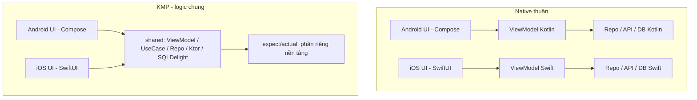

# Đánh giá Kotlin Multiplatform & kế hoạch học

> Góc nhìn: một người làm mobile lâu năm (Android/Kotlin + iOS), đồng thời đứng ở vị trí người bỏ tiền ra làm sản phẩm.
> Cập nhật: **10/2026**. KMP thay đổi rất nhanh, nên mỗi mốc phiên bản dưới đây cần kiểm lại khi đọc.

## Kết luận ngắn

| Câu hỏi | Trả lời ngắn |
|---|---|
| KMP đã dùng cho production được chưa? | **Được**, với phần logic dùng chung. Compose Multiplatform cho iOS cũng đã Stable (từ bản 1.8.0, 05/2025). |
| Có tiết kiệm thật không? | Có, nhưng **không phải 50%**. Thực tế khoảng 20–35% công sức cho phần logic, sau khi đã trả chi phí dựng ban đầu. |
| Rủi ro lớn nhất | Phía iOS: build chậm, interop Swift, crash khó đọc, team iOS thấy KMP là "hộp đen". |
| Học có đáng không? | Rất đáng: học một lần Kotlin, Coroutines, kiến trúc sạch, rồi dùng được cho cả Android, iOS và backend. |
| Nên bắt đầu thế nào | Chỉ share **logic** trước (domain, data, network). Giữ UI native. Share UI là bước sau, làm khi có lý do rõ. |

## Bối cảnh 10/2026: các mốc cần biết

- **Kotlin 2.4.x** là dòng hiện tại (2.4.21, 10/2026). **Swift export** đã lên Alpha: Swift gọi Kotlin trực tiếp, không cần đi vòng qua header Objective-C.
- Từ Kotlin **2.4.0**, project KMP khai báo được **Swift package làm dependency**; từ **2.4.20** có tự sinh `Package.swift`. Hướng đi là SwiftPM, còn CocoaPods đang dần bị bỏ.
- **AGP 9:** không dùng chung được plugin `com.android.library` với KMP trong cùng một module nữa, phải chuyển sang **Android-KMP library plugin**. Đây là lỗi build hàng đầu khi nâng cấp.
- **IDE:** dùng IntelliJ IDEA hoặc Android Studio, cài kèm plugin KMP. Từ IntelliJ 2026.3, plugin này **bỏ phần sửa code Swift**, nên Swift vẫn viết trong Xcode. Chạy app iOS và debug Kotlin trên iOS thì vẫn hỗ trợ đầy đủ.
- **VS Code:** extension Kotlin chính thức (LSP) mới ở Alpha; hỗ trợ KMP *đang được phát triển*. Chỉ nên dùng làm editor phụ.

---

## 1. Góc nhìn kỹ thuật lâu năm: tình hình thật

**Điểm mạnh thật sự**

- Phần **không có UI** (model, luật nghiệp vụ, gọi API, cache, parse dữ liệu, state machine) là phần đắt nhất khi viết 2 lần, và cũng hay lệch nhau nhất giữa 2 nền tảng. KMP giải đúng chỗ này.
- Không có runtime trung gian: phía Android là Kotlin/JVM bình thường, phía iOS là binary native qua LLVM. Không WebView, không bridge JS.
- Áp dụng **từng phần** được: gắn một module shared vào app native đang chạy, không phải viết lại từ đầu.

**Điểm phải nói thẳng**

- Trải nghiệm phía iOS vẫn là công dân hạng hai. JetBrains cũng tự nhận trong roadmap rằng DX trên iOS "còn nhiều chỗ cần cải thiện".
- Thời gian build Kotlin/Native chậm hơn rõ so với build Android, nhất là bản release và khi build nhiều kiến trúc CPU.
- Hệ sinh thái mỏng hơn Android thuần: nhiều SDK của bên thứ ba (thanh toán, bản đồ, BLE, analytics) chưa có bản KMP, nên phải tự viết `expect/actual` hoặc bọc lại.
- Mỗi lần nâng Kotlin, AGP, Gradle, Xcode là một lần rủi ro, vì có một **ma trận phiên bản** phải khớp nhau.

**Đánh giá:** KMP đã chín cho mô hình *"logic chung, UI riêng"*. Mô hình *"cả UI chung"* (Compose Multiplatform) đã dùng được, nhưng cần cân nhắc tùy sản phẩm: app cần cảm giác iOS thuần thì vẫn nên viết SwiftUI.

---

## 2. Góc nhìn người làm chủ: lợi ích kinh tế

### Tiền thật nằm ở đâu

Giả sử một app có tỉ lệ code như sau (ví dụ minh họa, không phải số đo):

| Phần | Tỉ lệ code | Share được? |
|---|---|---|
| UI, màn hình | 40–50% | Không (nếu giữ UI native) |
| Logic, data, network | 35–45% | **Có** |
| Code gắn với nền tảng (quyền, BLE, camera, push) | 10–20% | Một phần, qua `expect/actual` |

Phần share được chỉ viết một lần thay vì hai lần, nhưng phải cộng thêm chi phí: dựng project, lớp interop cho iOS, CI chạy trên máy macOS, và thời gian để team quen. Nên thực tế chỉ tiết kiệm khoảng **20–35% tổng công**, không phải 50%.

### Lợi ích khó đo nhưng có giá trị lớn

- **Ít bug lệch nền tảng:** một luật nghiệp vụ, một chỗ sửa, có test chung. Bug kiểu "Android đúng, iOS sai" giảm mạnh.
- **Ra tính năng đồng thời** trên 2 nền tảng: logic xong một lần, hai team UI làm song song.
- **Tuyển người dễ hơn:** dev Kotlin/Android nhiều hơn dev Swift giỏi, và dev Android góp được vào phía iOS ở phần logic.
- **Lối thoát rẻ:** module shared chỉ là một thư viện. Nếu bỏ KMP, phía Android giữ nguyên code, phía iOS viết lại phần logic, còn UI không mất gì.

### Chi phí ẩn cần tính trước

- Máy macOS cho CI (bắt buộc để build iOS), và thời gian build lâu hơn.
- Có thể cần một người "trực KMP": nâng phiên bản, sửa lỗi build, viết lớp bọc cho iOS.
- Team iOS phải học đọc Kotlin. Nếu họ phản đối, chi phí "con người" còn lớn hơn chi phí kỹ thuật.

### Khi nào **không** đáng tiền

- App chỉ có 1 nền tảng, hoặc app gần như toàn UI, ít logic.
- Team chỉ có web: Ionic/Capacitor hoặc React Native rẻ hơn.
- Dự án ngắn hạn kiểu prototype: chi phí dựng ban đầu không kịp hoàn vốn.

---

## 3. Lợi ích kỹ thuật: được gì, học được gì, làm được gì

| | Cụ thể |
|---|---|
| **Được** | Một code base logic, một bộ test cho logic, model dữ liệu đồng nhất, ít lệch hành vi giữa 2 nền tảng |
| **Học được** | Kotlin (null safety, sealed class, coroutines, Flow), kiến trúc phân lớp sạch, Gradle, cách iOS nhận một framework native, ranh giới giữa code chung và code riêng nền tảng |
| **Làm được** | App Android + iOS (+ Desktop) với logic chung; thư viện SDK dùng cho nhiều nền tảng; dùng lại cùng model và logic ở backend Ktor |
| **Tiết kiệm** | Viết và test logic 1 lần; sửa bug 1 chỗ; review 1 PR thay vì 2 |

Giá trị lớn nhất cho người học: KMP **ép phải tách UI khỏi logic** cho đúng. Ai làm KMP vài tháng sẽ viết code native thuần sạch hơn hẳn.

---

## 4. Khó khăn phải đối mặt và tâm thế xử lý

### Các loại lỗi hay gặp

| Loại | Ví dụ điển hình |
|---|---|
| **Build fail** | Lệch phiên bản Kotlin/AGP/Gradle/Compose; lỗi AGP 9 với plugin Android cũ; Xcode mới chưa được Kotlin/Native hỗ trợ; lỗi cache Kotlin/Native; build nhầm kiến trúc simulator (arm64 / x86_64) |
| **Crash iOS** | Exception Kotlin không được bắt chạy qua Swift → app chết bằng `konan::abort()`, stack trace khó đọc. Quên `@Throws` trên hàm được Swift gọi |
| **Interop** | Generic bị mất kiểu khi qua Objective-C; sealed class thành class thường; `suspend` / `Flow` không khớp 1:1 với `async/await` của Swift |
| **Concurrency** | Cập nhật UI không ở main thread; coroutine scope sống sai vòng đời gây leak hoặc cancel sớm |
| **Hành vi khác nhau** | Ngày giờ, múi giờ, locale, đường dẫn file, encoding: cùng một code chung nhưng kết quả mỗi nền tảng một khác |
| **Bộ nhớ** | Vòng tham chiếu giữa Swift (ARC) và Kotlin (GC) làm object không được giải phóng |

### Tâm thế người có kinh nghiệm

1. **Lỗi build là chuyện bình thường, không phải tai nạn.** Ghim cứng phiên bản (version catalog), mỗi lần chỉ nâng **một** thứ, nâng trên branch riêng và chạy CI đủ mọi target.
2. **Đọc lỗi đầu tiên, không đọc lỗi cuối.** Gradle in ra hàng trăm dòng, nguyên nhân thật thường nằm ở dòng `Caused by:` đầu tiên.
3. **Tách nhỏ để khoanh vùng:** lỗi nằm ở common, Android hay iOS? Chạy `commonTest` trước. Nếu qua thì lỗi nằm ở phần nền tảng hoặc phần interop.
4. **Tái hiện bằng ví dụ tối thiểu** trước khi hỏi người khác hoặc hỏi AI: một project wizard mới, thêm từng thứ vào cho tới khi lỗi xuất hiện.
5. **Coi biên giới Kotlin ↔ Swift là API công khai:** thiết kế nó gọn, kiểu dữ liệu đơn giản, bắt hết exception ở biên giới và trả về `Result` hoặc sealed class.
6. **Ghi lại mỗi lỗi đã gặp** vào trang [Lỗi hay gặp](../reference/troubleshooting.md). Lần sau sửa trong 5 phút thay vì 5 giờ.

---

## 5. Cấu trúc và kiến trúc so với native thuần



| Khía cạnh | Native thuần | KMP |
|---|---|---|
| Module | 2 project độc lập | `shared/` (commonMain, androidMain, iosMain) + `androidApp/` + `iosApp/` |
| Logic | Viết 2 lần, 2 ngôn ngữ | Viết 1 lần ở `commonMain` |
| Gọi API nền tảng | Gọi trực tiếp | `expect/actual` hoặc interface + inject từ phía nền tảng |
| Thư viện | Retrofit/Room · URLSession/CoreData | Ktor, SQLDelight/Room KMP, kotlinx.serialization, Koin |
| Đưa sang iOS | Không cần | Framework `.framework` / XCFramework, hoặc Swift export |
| Build | Gradle · Xcode | Gradle build cả 2, Xcode gọi task Gradle khi build iOS |
| Test logic | 2 bộ test | 1 bộ `commonTest`, chạy trên mọi target |

**Quy tắc kiến trúc nên giữ:**

- `commonMain` **không biết** gì về UI. Chỉ phát ra state (`StateFlow`) và nhận vào hành động.
- Mọi thứ của nền tảng (BLE, camera, quyền, file) đi qua **interface** đặt ở common, phần cài đặt nằm ở `androidMain` / `iosMain`. Ưu tiên interface + DI hơn `expect/actual` để test dễ hơn.
- Biên giới với Swift: kiểu dữ liệu đơn giản, có lớp bọc thân thiện Swift (SKIE, hoặc Swift export khi đã ổn định).

---

## 6. Người có kinh nghiệm khác người mới ở đâu khi bắt đầu

| Người mới | Người có kinh nghiệm |
|---|---|
| Lao vào share càng nhiều càng tốt, kể cả UI | Share logic trước, đo được lợi rồi mới mở rộng |
| Copy cấu hình Gradle trên mạng | Dùng wizard, rồi **đọc hiểu** từng dòng Gradle |
| Thấy build fail là hoảng, đổi lung tung | Ghim phiên bản, đổi một biến một lần, đọc dòng `Caused by` |
| Chỉ chạy trên Android, "iOS chắc cũng vậy" | Chạy cả 2 nền tảng mỗi ngày, iOS là công dân hạng nhất |
| Để exception bay qua Swift | Bắt lỗi ở biên giới, trả `Result` |
| Tin code AI sinh ra | Kiểm phiên bản API, đối chiếu docs chính chủ, viết test trước |
| Học tính năng | Học **ranh giới**: cái gì chung, cái gì riêng, và vì sao |
| Không quan tâm build time, log, crash | Dựng log, crash report và CI **trước** khi viết tính năng |

Khác biệt lớn nhất: người có kinh nghiệm **thiết kế để debug được** ngay từ ngày đầu, còn người mới chỉ nghĩ tới debug khi đã có bug.

---

## 7. Trước khi bắt đầu: debug, phát hiện lỗi, log, test

Dựng đủ bộ này ở **bài 2–3**, trước khi viết tính năng.

### Log

- Dùng **Kermit** (Touchlab) trong `commonMain`: một API log, xuất ra Logcat trên Android và OSLog/Console trên iOS.
- Gắn tag theo module, có mức log (`d/i/w/e`). Bản release tắt log debug.
- Xem log: Android dùng Logcat; iOS dùng Xcode console hoặc app **Console.app** (lọc theo subsystem).

### Debug

- **Android:** IntelliJ / Android Studio, đặt breakpoint trong `commonMain` như code Kotlin thường.
- **iOS:** plugin KMP cho chạy app iOS và đặt breakpoint Kotlin ngay trong IntelliJ. Nếu muốn ở trong Xcode: plugin **xcode-kotlin** (Touchlab) cho breakpoint và xem biến Kotlin.
- Lỗi interop: mở header Objective-C được sinh ra (`shared.h`) để thấy Swift **thật sự** nhìn thấy gì.

### Phát hiện crash

- Android: Crashlytics hoặc Sentry như bình thường.
- iOS: Crashlytics + **CrashKiOS**, hoặc **Sentry KMP SDK**, để crash Kotlin có stack trace đọc được. Bắt buộc upload **dSYM** của cả framework shared.
- Dùng `setUnhandledExceptionHook` để log exception Kotlin trước khi app chết.

### Test bằng tay (manual)

- Ma trận tối thiểu: **Android máy thật + emulator; iOS máy thật + simulator**. Thêm một máy cấu hình yếu.
- Mỗi tính năng có checklist: luồng đúng, mất mạng, xoay màn, app vào nền rồi quay lại, đổi ngôn ngữ, đổi múi giờ.
- So **cùng một input** trên 2 nền tảng: kết quả logic phải giống hệt nhau.

### Automation

| Tầng | Công cụ | Chạy ở |
|---|---|---|
| Logic chung | `kotlin.test`, `kotlinx-coroutines-test`, **Turbine** (test Flow) | `commonTest`, chạy trên JVM + iOS simulator |
| Phần riêng nền tảng | JUnit (Android), XCTest (iOS) | `androidUnitTest`, `iosTest` / Xcode |
| UI | Compose UI test (Android/CMP), XCUITest (SwiftUI) | Emulator / simulator |
| E2E 2 nền tảng | **Maestro** (một file YAML chạy cả Android và iOS) | Máy local + CI |
| Chất lượng code | **detekt**, **ktlint**, SwiftLint | Mỗi PR |
| CI | Linux runner cho common + Android; **macOS runner** cho iOS | Mỗi PR + nightly |

---

## 8. Học nhanh mà vẫn hiểu "vi mô" bên dưới

Cách nhanh nhất là **đi theo đường đi của một dòng code** từ nguồn tới máy:

1. **Biên dịch:** Kotlin → IR → JVM bytecode (Android), hoặc → LLVM → mã máy ARM (iOS). Chạy `./gradlew :shared:linkDebugFrameworkIosSimulatorArm64`, rồi mở thư mục `build/bin/` xem framework sinh ra.
2. **Đọc header sinh ra:** mở `shared.h` và đối chiếu từng class Kotlin với dạng Objective-C của nó. Đây là cách nhanh nhất để hiểu interop.
3. **Gradle task graph:** chạy `./gradlew tasks --all` và `--scan` một lần, để hiểu Xcode gọi Gradle thế nào.
4. **Luồng và vòng đời:** in tên thread trong từng coroutine; so `Dispatchers.Main` trên Android và trên iOS; theo dõi ViewModel sống và chết khi xoay màn (Android) hoặc khi đóng view (iOS).
5. **Bộ nhớ:** dùng Instruments (Leaks, Allocations) trên iOS, Memory Profiler trên Android, và cố ý tạo một vòng tham chiếu Swift ↔ Kotlin để thấy nó leak.
6. **Phá rồi sửa:** mỗi bài cố tình gây 1 lỗi (bỏ `@Throws`, đổi sai phiên bản, gọi UI ngoài main thread), xem nó biểu hiện ra sao, rồi sửa.
7. **Đọc source thư viện:** mở code của Ktor engine Darwin và OkHttp xem `actual` được viết thế nào. Đó là mẫu `expect/actual` chuẩn nhất.

Quy tắc: mỗi khái niệm phải **chạy được trên cả 2 nền tảng và giải thích được bằng lời của mình** thì mới coi là hiểu.

---

## 9. Quy trình spec → sản phẩm chạy được khi có AI hỗ trợ

```
Spec → Tiêu chí chấp nhận → Hợp đồng (interface, model) ở commonMain
     → Test trước ở commonTest → AI viết phần cài đặt → Test xanh
     → UI Android + UI iOS (song song) → Kiểm tra theo cổng → Release
```

| Bước | Người làm | AI làm | Cổng phải qua |
|---|---|---|---|
| 1. Spec | Viết yêu cầu, phạm vi, trường hợp lỗi | Hỏi lại chỗ mơ hồ, liệt kê edge case | PO/QA đồng ý tiêu chí chấp nhận |
| 2. Hợp đồng | Duyệt interface, model, state | Đề xuất interface, sealed state | Review: tên, kiểu dữ liệu, biên giới Swift |
| 3. Test trước | Duyệt danh sách case | Viết test `commonTest` | Test **đỏ** đúng lý do |
| 4. Cài đặt | Review từng diff | Viết code cho test xanh | Test xanh trên JVM **và** iOS |
| 5. UI | Kiểm UX, khớp thiết kế | Sinh Compose / SwiftUI theo state | Chạy trên máy thật 2 nền tảng |
| 6. Kiểm tra | Test tay theo checklist | Viết flow Maestro | Lint, unit, E2E, build release đều xanh |
| 7. Release | Quyết định phát hành | Viết changelog | Crash report sạch sau khi rollout dần |

**Bẫy khi dùng AI với KMP:**

- AI hay sinh **API hoặc DSL Gradle đã cũ** (KMP đổi rất nhanh: AGP 9, SwiftPM, Swift export). Luôn đưa kèm phiên bản đang dùng và link docs chính chủ vào prompt.
- AI hay quên phía iOS: chỉ viết `androidMain`, hoặc quên `@Throws`. Bắt buộc cổng "build iOS xanh".
- **"Đảm bảo không lỗi" là không có thật.** Cái làm được là: test phủ logic chung, E2E phủ luồng chính, crash report, rollout dần, và có đường rollback. Định nghĩa rõ "Done" thay vì hứa "không lỗi".

---

## 10. Hạn chế của KMP hiện nay

- **iOS DX:** build chậm hơn, debug Kotlin trên iOS kém mượt hơn Swift thuần, IDE bỏ phần sửa Swift.
- **Interop:** vẫn chủ yếu đi qua Objective-C (generic, sealed, `suspend`, Flow bị biến đổi). Swift export mới ở **Alpha**.
- **Hệ sinh thái:** nhiều SDK bên thứ ba chưa có bản KMP; SwiftPM dependency mới có từ Kotlin 2.4.
- **Nâng cấp tốn công:** ma trận Kotlin × AGP × Gradle × Xcode × Compose phải khớp nhau; AGP 9 là một đợt migrate bắt buộc.
- **Kích thước app iOS** tăng thêm vì phải kèm runtime Kotlin/Native.
- **Crash iOS** cần cấu hình thêm (CrashKiOS/Sentry, dSYM) mới đọc được.
- **Công cụ VS Code** chưa hỗ trợ KMP đầy đủ.
- **Con người:** team iOS có thể phản đối; cần người hiểu cả 2 phía.

---

## 11. Người mới: đốt cháy giai đoạn mà vẫn nắm chắc

**Lộ trình 6 tuần chạy hết sức**, gắn với 14 bài của site này:

| Tuần | Mục tiêu | Bài | Kết quả phải có |
|---|---|---|---|
| 1 | Kotlin cốt lõi + máy chạy được | 1–3 | App wizard chạy trên 3 nền tảng; giải thích được từng file Gradle |
| 2 | Code chung + thư viện | 4–5 | `expect/actual` + interface; Kermit log được trên cả 2 nền tảng |
| 3 | UI + state | 6–8 | Màn danh sách, chi tiết; ViewModel + Flow; xoay màn không mất state |
| 4 | Dữ liệu + mạng | 9–10 | SQLDelight + Ktor; xử lý mất mạng; test Repository bằng fake |
| 5 | iOS + test | 11–12 | SwiftUI gọi shared; test `commonTest` chạy trên iOS simulator; flow Maestro đầu tiên |
| 6 | Phát hành | 13–14 | Bản release có crash report; CI build 2 nền tảng; tự viết lại 1 tính năng không nhìn bài |

**Nhịp mỗi ngày (khoảng 3–4 giờ):**

1. 30 phút: đọc docs chính chủ của bài.
2. 90 phút: code tính năng, chạy trên **cả 2** nền tảng.
3. 30 phút: cố tình phá rồi sửa (xem mục 8).
4. 30 phút: viết test.
5. 15 phút: ghi lại 3 điều học được và 1 lỗi gặp phải vào nhật ký.

**Mẹo tăng tốc thật sự:** dùng AI để **giải thích** và **hỏi ngược** mình, không phải để viết hộ. Mỗi đoạn AI sinh ra phải tự gõ lại hoặc giải thích lại từng dòng được.

---

## 12. Chạy nhanh: được gì, mất gì, và chuyện tách UI

### Đánh đổi khi chạy nhanh

| Được | Mất / rủi ro |
|---|---|
| Có sản phẩm chạy sớm, có động lực | Hiểu nông: chạy được nhưng không giải thích được vì sao |
| Gặp nhiều lỗi thật sớm, nên học nhanh | Nợ kỹ thuật: Gradle copy về, kiến trúc lộn xộn |
| Biết sớm mình hợp hay không với KMP | Bỏ qua iOS, test, log; trả giá gấp nhiều lần về sau |
| | Kiệt sức nếu chạy kiểu "burn" quá 6–8 tuần liền |

**Dấu hiệu đang chạy nhanh quá mà không hiểu:**

- Không tự giải thích được một file Gradle hay một `expect/actual` mình viết.
- Sửa lỗi bằng cách thử ngẫu nhiên cho tới khi chạy.
- Chỉ test trên Android.
- Không viết lại được tính năng khi không có AI hay bài mẫu.

Gặp 2 trong 4 dấu hiệu trên thì nên **lùi 1–2 ngày để củng cố** trước khi đi tiếp.

### Tách UI làm riêng (người chuyên UI)

Mô hình: một người hoặc team lo `shared` (logic, state), một người hoặc team lo UI (Compose / SwiftUI).

**Lợi:**

- Hai bên làm song song; UI dựng được trên **state giả** (fake ViewModel, Preview) trước khi có API.
- Người giỏi UI tập trung vào UX, animation và chuẩn từng nền tảng.
- Hợp đồng state rõ ràng, nên test logic không cần UI.

**Xung đột có thể xảy ra:**

| Với ai | Xung đột | Cách xử lý |
|---|---|---|
| **PM / PO** | Thấy UI đẹp chạy demo nên tưởng xong, trong khi logic chưa có | Demo luôn ghi rõ "đang dùng dữ liệu giả"; Definition of Done tính cả logic và tích hợp |
| **PM / PO** | Đổi yêu cầu giữa chừng, phải sửa cả hợp đồng state lẫn 2 UI | Chốt hợp đồng state trước sprint; đổi yêu cầu thì đánh giá lại ước lượng |
| **QA** | Bug không rõ của bên nào (UI hay shared) nên bị đẩy qua đẩy lại | Log có tag theo tầng; tách test logic khỏi test UI; mỗi bug ghi rõ tầng |
| **QA** | Hai nền tảng hành vi khác nhau, không rõ đâu là "đúng" | Tiêu chí chấp nhận viết theo **state**, không theo màn hình; một bộ test logic chung là nguồn sự thật |
| **Giữa 2 team** | Team UI chờ team shared, hoặc ngược lại | Hợp đồng (interface + sealed state) có trước, dùng fake để không chặn nhau |

**Kết luận:** tách UI có lợi khi **hợp đồng state được chốt trước** và Definition of Done tính cả tích hợp. Thiếu 2 điều đó thì tách UI chỉ dời xung đột sang giai đoạn tích hợp và QA.

---

## Bước tiếp theo

- [ ] Bài 1–3: dựng project, cài Kermit, dựng CI build cả 2 nền tảng.
- [ ] Thêm CrashKiOS hoặc Sentry vào bản iOS ngay từ tuần 2.
- [ ] Viết flow Maestro đầu tiên ở tuần 5.
- [ ] Ghi mọi lỗi build/crash gặp phải vào [Lỗi hay gặp](../reference/troubleshooting.md).

## Nguồn

- [What's new in Kotlin 2.4.0](https://kotlinlang.org/docs/whatsnew24.html) · [Kotlin 2.4.20 Released](https://blog.jetbrains.com/kotlin/2026/09/kotlin-2-4-20-released/) · [Kotlin release process](https://kotlinlang.org/docs/releases.html)
- [Compose Multiplatform 1.8.0: iOS Stable](https://blog.jetbrains.com/kotlin/2025/05/compose-multiplatform-1-8-0-released-compose-multiplatform-for-ios-is-stable-and-production-ready/)
- [Recommended IDEs for KMP](https://kotlinlang.org/docs/multiplatform/recommended-ides.html) · [Discontinuing Swift IDE support in the KMP plugin](https://blog.jetbrains.com/kotlin/2026/10/discontinuing-swift-language-ide-support-in-the-kotlin-multiplatform-plugin/)
- [Kotlin Language Server (VS Code)](https://kotlinlang.org/docs/kotlin-lsp.html) · [Official Kotlin support for VS Code (Alpha)](https://blog.jetbrains.com/kotlin/2026/05/official-kotlin-support-for-visual-studio-code-is-now-available-in-alpha/)
- [Migrating KMP projects to AGP 9](https://kotlinlang.org/docs/multiplatform/multiplatform-project-agp-9-migration.html) · [KT-53877: SwiftPM support](https://youtrack.jetbrains.com/projects/KT/issues/KT-53877/Support-Swift-Package-Manager-in-Kotlin-Multiplatform)
- [KMP roadmap 08/2025](https://blog.jetbrains.com/kotlin/2025/08/kmp-roadmap-aug-2025/) · [KMP in production: the multi-team reality](https://proandroiddev.com/kotlin-multiplatform-in-production-the-write-once-dream-vs-the-multi-team-reality-09d2e9339f47)
- [CrashKiOS + Crashlytics](https://crashkios.touchlab.co/docs/crashlytics) · [Touchlab: build only what you need](https://touchlab.co/touchlab-build-only-what-you-need)
