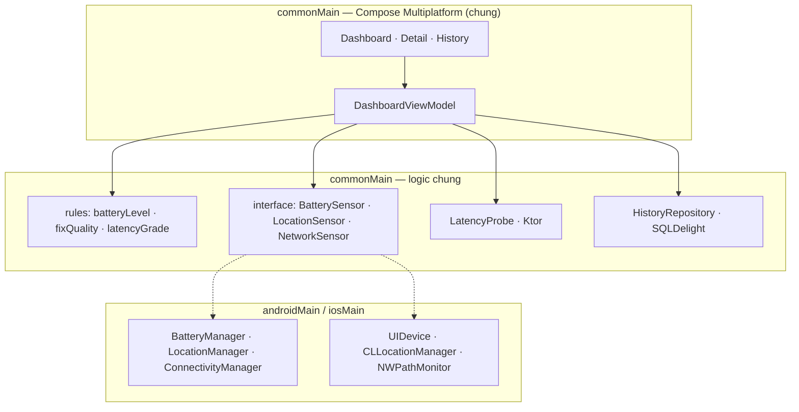

# Dự án: Device Pulse

Mọi bài trong lộ trình đều ráp vào **một** app: **Device Pulse**, app đo nhanh "sức khỏe" của điện thoại: **pin, vị trí GPS, mạng**.
Đây là bài tập KMP rất "thật": UI và logic viết chung một lần, còn 3 cảm biến bắt buộc phải gọi API riêng của Android và iOS.

## Device Pulse làm gì

Một màn **Dashboard** có 3 thẻ. Bấm thẻ nào thì mở màn chi tiết của thẻ đó.

| Thẻ | Hiện gì | Đánh giá chung (viết ở `commonMain`) |
|---|---|---|
| 🔋 **Pin** | % pin, đang sạc / đang xả / đầy | `Critical` ≤ 10% · `Low` ≤ 20% · `Ok` |
| 📍 **Vị trí** | Vĩ độ, kinh độ, sai số (m), tốc độ | `Good` ≤ 20 m · `Fair` ≤ 100 m · `Poor` |
| 📶 **Mạng** | Wi-Fi / di động / có dây / mất mạng; **đo độ trễ** HTTP | `Fast` < 100 ms · `Ok` < 300 ms · `Slow` |
| 🕘 **Lịch sử** | Bấm "Lưu lần đo" để ghi lại; xem danh sách các lần đo | — |

Mỗi cảm biến luôn trả về một trong 5 trạng thái: `Loading`, `Available`, `PermissionDenied`, `Unsupported` (ví dụ đo pin
trên iOS Simulator), `Error`. UI chỉ cần vẽ 5 trạng thái đó, không phải lo exception.

## Phạm vi

| Có | Làm sau |
|---|---|
| Dashboard 3 thẻ + màn chi tiết | Theo dõi chạy ngầm |
| Pin, GPS, mạng **đọc thật** trên Android + iOS | Thông báo khi pin yếu / mất mạng |
| Xin quyền vị trí, xử lý khi bị từ chối | Biểu đồ theo thời gian |
| Đo độ trễ HTTP bằng Ktor | Xuất file CSV |
| Lưu lịch sử offline (SQLDelight) | Widget, Desktop |
| Tiếng Việt + tiếng Anh | |
| Android + iOS | |

## Kiến trúc



- **UI + ViewModel + luật đánh giá + đo độ trễ + lịch sử**: viết một lần ở `commonMain`.
- **3 cảm biến**: mỗi cái là một `interface` ở `commonMain`, có 2 bản cài đặt ở `androidMain` và `iosMain`, gắn vào bằng Koin.
- Không exception nào được chạy qua ranh giới cảm biến: lỗi nào cũng thành `Reading.Error` / `PermissionDenied` / `Unsupported`.

## Cấu trúc thư mục cuối cùng

```text
DevicePulse/
├── composeApp/
│   └── src/
│       ├── commonMain/kotlin/dev/devicepulse/
│       │   ├── model/        # BatteryInfo, LocationFix, NetworkStatus, Reading
│       │   ├── rules/        # batteryLevel, fixQuality, latencyGrade
│       │   ├── sensor/       # interface cảm biến, LatencyProbe, permission
│       │   ├── data/         # HistoryRepository (SQLDelight)
│       │   ├── di/           # Koin modules
│       │   └── ui/           # Dashboard, Detail, History, ViewModel
│       ├── commonMain/sqldelight/…       # PulseDb .sq
│       ├── commonMain/composeResources/  # strings vi/en, icon
│       ├── androidMain/…     # MainActivity, cảm biến Android
│       ├── iosMain/…         # MainViewController, cảm biến iOS
│       └── commonTest/…      # test luật, ViewModel, LatencyProbe
├── iosApp/                   # project Xcode bọc app (Info.plist: quyền vị trí)
└── gradle/libs.versions.toml
```

## Thiết bị để thử

| | Android | iOS |
|---|---|---|
| Pin | Emulator → Extended Controls → Battery | **Phải dùng iPhone thật** (Simulator trả `Unsupported`) |
| Vị trí | Extended Controls → Location | Simulator → Features → Location |
| Mạng | Bật/tắt Wi-Fi, chế độ máy bay | Tắt Wi-Fi của Mac, hoặc dùng iPhone thật |

## Tiếp theo?

- Xem [checklist hoàn thành](checklist.md) để biết "xong" nghĩa là gì.
- Bắt đầu [bài 1](../lessons/01-what-is-kmp.md).
