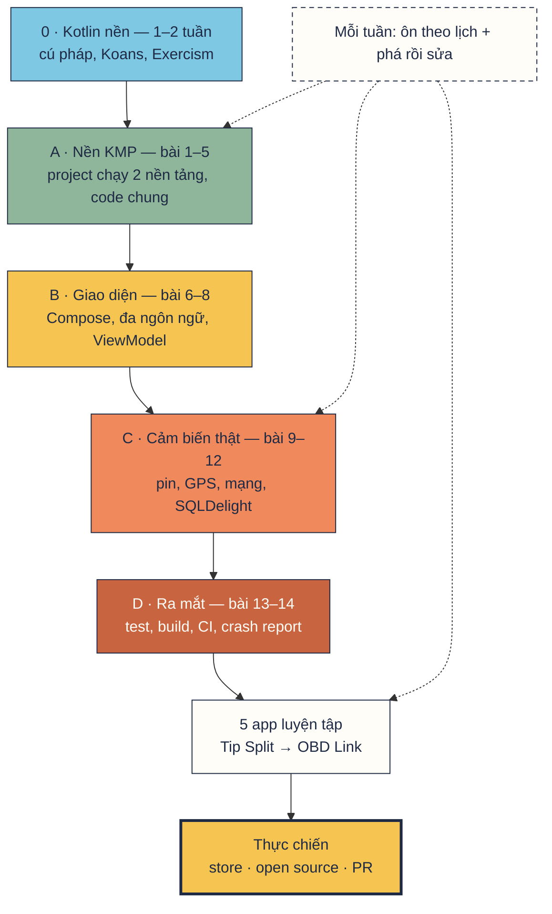
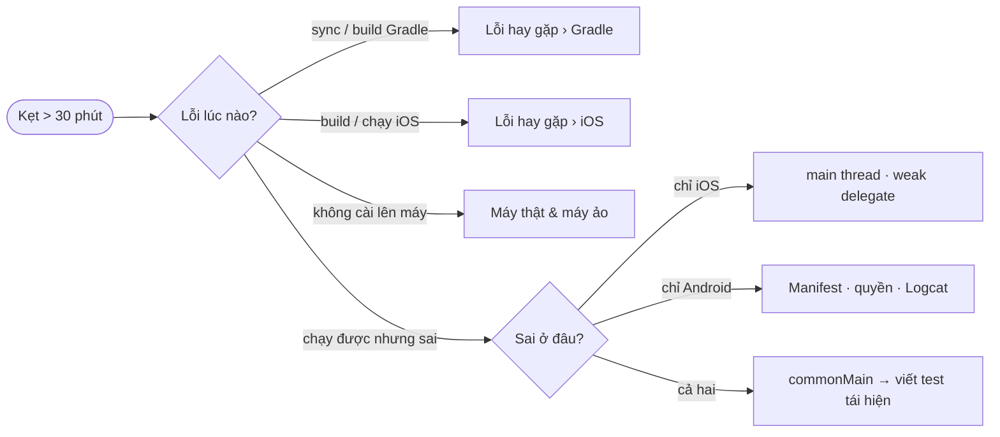

# Sơ đồ lộ trình

Một trang để **nhìn là biết làm gì**: đang ở trạm nào, trạm đó làm gì, xong khi nào, hay vấp ở đâu và vấp thì mở trang nào.
Đọc từ trên xuống, như một tuyến tàu: mỗi chặng có **cổng**, chưa qua cổng thì chưa sang chặng sau.

  <b class="lg lg--do">Làm</b> việc phải gõ tay
  <b class="lg lg--ok">Xong khi</b> chạy thật được thế này
  <b class="lg lg--trap">Hay vấp</b> bấm vào là tới cách sửa
  <b class="lg lg--gate">🚦 Cổng</b> điều kiện để sang chặng sau

## Toàn cảnh { #toan-canh }

<nav class="rmap-strip">
  <a href="#chang-0" style="--zc: var(--sky)">0 · Kotlin nền</a>
  <a href="#chang-a" style="--zc: var(--sage)">A · Nền KMP</a>
  <a href="#chang-b" style="--zc: var(--sun)">B · Giao diện</a>
  <a href="#chang-c" style="--zc: var(--coral)">C · Cảm biến</a>
  <a href="#chang-d" style="--zc: var(--terra)">D · Ra mắt</a>
  <a href="#luyen-tap" style="--zc: var(--paper)">5 app</a>
  <a href="#thuc-chien" style="--zc: var(--ink)">Thực chiến</a>
</nav>

## Bạn đang ở đâu? { #dang-o-dau }

| Nếu bạn… | Bắt đầu ở |
|---|---|
| Chưa viết Kotlin bao giờ, chưa rõ `val` / `var`, lambda | [Chặng 0](#chang-0) |
| Biết Kotlin/Android, chưa đụng KMP | [Chặng A, bài 1](#chang-a) |
| Đã có project KMP chạy 2 nền tảng, chưa có UI chung | [Chặng B](#chang-b) |
| UI chạy với dữ liệu giả, chưa đọc cảm biến thật | [Chặng C](#chang-c) |
| App chạy đủ, chưa có test / bản phát hành | [Chặng D](#chang-d) |
| Xong 14 bài | [5 app luyện tập](#luyen-tap) + [thực chiến](#thuc-chien) |

## Chặng 0 · Kotlin nền { #chang-0 }

  
0.1<a class="st__t" href="https://kotlinlang.org/docs/kotlin-tour-welcome.html">Kotlin tour</a>

  
<b class="lg lg--do">Làm</b> Đi hết cú pháp: biến, null safety, collection, lambda, class

  
<b class="lg lg--ok">Xong khi</b> Đọc code bài 4 không phải tra cú pháp

  
<b class="lg lg--trap">Hay vấp</b> Đọc mãi không gõ → mở <a href="https://play.kotlinlang.org/">Playground</a> gõ song song

  
0.2<a class="st__t" href="https://play.kotlinlang.org/koans/overview">Koans + Exercism</a>

  
<b class="lg lg--do">Làm</b> 20 Koans + 5 bài <a href="https://exercism.org/tracks/kotlin">Exercism</a>, xin mentor review 1 bài

  
<b class="lg lg--ok">Xong khi</b> Viết được <code>map</code> / <code>filter</code> / <code>when</code> không nhìn

  
<b class="lg lg--trap">Hay vấp</b> Viết kiểu Java → đọc <a href="../reference/kotlin-conventions/">quy ước Kotlin</a> mục idiom

  
0.3<a class="st__t" href="../extend/practice/#nguyen-tac">Cài thói quen học</a>

  
<b class="lg lg--do">Làm</b> Tạo <code>NOTES.md</code> nhật ký lỗi, đặt lịch <a href="../extend/practice/#vong-tuan">vòng tuần</a>

  
<b class="lg lg--ok">Xong khi</b> Có lịch ôn 1–3–7–21 ngày trong điện thoại

  
<b class="lg lg--trap">Hay vấp</b> Coroutine chưa hiểu → chỉ cần <code>suspend</code> + <code>launch</code>, phần còn lại học dần

<b>🚦 Cổng 0</b> Viết được một data class + một hàm lọc list + một <code>suspend fun</code> trên file trắng.

## Chặng A · Nền KMP { #chang-a }

  
1<a class="st__t" href="../lessons/01-what-is-kmp/">KMP là gì, khi nào dùng</a>

  
<b class="lg lg--do">Làm</b> Hiểu 3 lớp app (UI · logic · nền tảng), đọc đích Device Pulse

  
<b class="lg lg--ok">Xong khi</b> Nói được lớp nào share, lớp nào viết riêng

  
<b class="lg lg--trap">Hay vấp</b> Muốn share hết kể cả UI ngay → <a href="../plan/kmp-review/">Đánh giá KMP</a>

  
2<a class="st__t" href="../lessons/02-setup/">Cài máy, tạo project</a>

  
<b class="lg lg--do">Làm</b> Android Studio + Xcode, wizard tạo <code>DevicePulse</code>

  
<b class="lg lg--ok">Xong khi</b> Chạy trên emulator <b>và</b> simulator, sửa <code>App.kt</code> 2 bên đổi theo

  
<b class="lg lg--trap">Hay vấp</b> <a href="../reference/troubleshooting/#gradle">Gradle JVM incompatible</a> · <a href="../reference/troubleshooting/#ios-xcode">không thấy Xcode</a> · <a href="../reference/devices/">máy thật</a>

  
3<a class="st__t" href="../lessons/03-project-structure/">Cấu trúc project</a>

  
<b class="lg lg--do">Làm</b> Đọc target, source set, <code>build.gradle.kts</code>; tạo package

  
<b class="lg lg--ok">Xong khi</b> Giải thích được <code>commonMain</code> / <code>androidMain</code> / <code>iosMain</code>

  
<b class="lg lg--trap">Hay vấp</b> Gọi API Android trong <code>commonMain</code> → <a href="../reference/troubleshooting/#gradle">Unresolved reference</a>

  
4<a class="st__t" href="../lessons/04-share-code/">Chia sẻ code</a>

  
<b class="lg lg--do">Làm</b> Model <code>Reading</code>, 3 hàm luật, interface cảm biến, <code>expect</code>/<code>actual</code>

  
<b class="lg lg--ok">Xong khi</b> <code>latencyGrade(300)</code> = <code>Slow</code>; xoá <code>actual</code> iOS thì build đỏ

  
<b class="lg lg--trap">Hay vấp</b> <a href="../lessons/04-share-code/#loi-hay-gap">expect/actual lệch package · exception lọt Flow</a>

  
5<a class="st__t" href="../lessons/05-dependencies/">Thêm thư viện</a>

  
<b class="lg lg--do">Làm</b> Version catalog, Koin (common + platform module), Kermit

  
<b class="lg lg--ok">Xong khi</b> Log hiện ở Logcat <b>và</b> console Xcode

  
<b class="lg lg--trap">Hay vấp</b> Thư viện sai source set · <code>KoinApplication has not been started</code> → <a href="../lessons/05-dependencies/#koin-commonmodule-platformmodule">Koin</a>

<b>🚦 Cổng A</b> Project chạy 2 nền tảng; tự giải thích được vì sao <code>BatterySensor</code> là interface.
<a href="../project/checklist/#chang-a-nen">Tick checklist A</a>

## Chặng B · Giao diện { #chang-b }

  
6<a class="st__t" href="../lessons/06-compose-basics/">Compose cơ bản</a>

  
<b class="lg lg--do">Làm</b> Dashboard 3 thẻ với dữ liệu giả, <code>@Preview</code>

  
<b class="lg lg--ok">Xong khi</b> Vẽ đủ 5 trạng thái <code>Reading</code> trên 2 nền tảng

  
<b class="lg lg--trap">Hay vấp</b> Tai thỏ iOS che tiêu đề (thiếu safe area) · Preview không hiện

  
7<a class="st__t" href="../lessons/07-resources/">Resources, đa ngôn ngữ</a>

  
<b class="lg lg--do">Làm</b> Chuỗi vi/en, icon, định dạng khoảng cách

  
<b class="lg lg--ok">Xong khi</b> Đổi ngôn ngữ máy, app đổi theo cả 2 bên

  
<b class="lg lg--trap">Hay vấp</b> <a href="../lessons/07-resources/#loi-hay-gap"><code>Res</code> thiếu chuỗi · iOS không ra tiếng Việt</a>

  
8<a class="st__t" href="../lessons/08-viewmodel-navigation/">ViewModel, điều hướng</a>

  
<b class="lg lg--do">Làm</b> <code>DashboardViewModel</code> + sensor giả + route type-safe

  
<b class="lg lg--ok">Xong khi</b> Xoay màn không mất state; Dashboard → Detail → Back

  
<b class="lg lg--trap">Hay vấp</b> <code>Serializer for class 'DetailRoute' is not found</code> → thiếu plugin serialization

<b>🚦 Cổng B</b> Đổi giá trị sensor giả → UI 2 nền tảng đổi theo, không sửa dòng UI nào.
<a href="../project/checklist/#chang-b-giao-dien">Tick checklist B</a>

## Chặng C · Cảm biến thật { #chang-c }

!!! warning "Chặng này cần máy thật"
    iOS Simulator **không đo được pin**. Chuẩn bị iPhone / Android thật trước: [Máy thật & máy ảo](reference/devices.md).

  
9<a class="st__t" href="../lessons/09-battery/">Đọc pin</a>

  
<b class="lg lg--do">Làm</b> <code>callbackFlow</code>: sticky broadcast (Android), <code>UIDevice</code> (iOS)

  
<b class="lg lg--ok">Xong khi</b> Kéo % pin emulator, thẻ đổi; Simulator báo "Không hỗ trợ"

  
<b class="lg lg--trap">Hay vấp</b> Tưởng Simulator lỗi (thật ra là <code>Unsupported</code> đúng) · <a href="../reference/devices/#4-iphone-that">ký app iPhone thật</a>

  
10<a class="st__t" href="../lessons/10-location/">GPS, xin quyền</a>

  
<b class="lg lg--do">Làm</b> <code>expect</code> composable xin quyền, <code>LocationManager</code> / <code>CLLocationManager</code>

  
<b class="lg lg--ok">Xong khi</b> Từ chối quyền → báo gọn, không crash

  
<b class="lg lg--trap">Hay vấp</b> <a href="../lessons/10-location/#quyen-expect-composable">Delegate iOS là weak → bị GC, callback im lặng</a>

  
11<a class="st__t" href="../lessons/11-network/">Mạng, độ trễ</a>

  
<b class="lg lg--do">Làm</b> <code>ConnectivityManager</code> / <code>nw_path_monitor</code>, Ktor 2 engine

  
<b class="lg lg--ok">Xong khi</b> Bật máy bay → thẻ đổi ngay; đo được ms

  
<b class="lg lg--trap">Hay vấp</b> <a href="../reference/troubleshooting/#runtime">Thiếu quyền INTERNET · NoTransformationFound</a>

  
12<a class="st__t" href="../lessons/12-history-sqldelight/">Lịch sử với SQLDelight</a>

  
<b class="lg lg--do">Làm</b> File <code>.sq</code>, driver theo nền tảng, repository trả <code>Flow</code>

  
<b class="lg lg--ok">Xong khi</b> Tắt hẳn app mở lại vẫn còn lịch sử

  
<b class="lg lg--trap">Hay vấp</b> <a href="../reference/troubleshooting/#runtime">Ghi DB xong list không cập nhật</a>

<b>🚦 Cổng C</b> Trên máy thật: pin, vị trí, mạng thật; lưu → tắt app → mở lại vẫn còn.
<a href="../project/checklist/#chang-c-cam-bien-that">Tick checklist C</a>

## Chặng D · Ra mắt { #chang-d }

  
13<a class="st__t" href="../lessons/13-testing/">Test</a>

  
<b class="lg lg--do">Làm</b> Test luật, sensor giả, <code>MockEngine</code>, ViewModel

  
<b class="lg lg--ok">Xong khi</b> Xanh trên <code>testDebugUnitTest</code> <b>và</b> <code>iosSimulatorArm64Test</code>

  
<b class="lg lg--trap">Hay vấp</b> Chỉ chạy test JVM, quên iOS · test coroutine treo (thiếu <code>runTest</code>)

  
14<a class="st__t" href="../lessons/14-build-publish/">Build, phát hành</a>

  
<b class="lg lg--do">Làm</b> AAB đã ký, archive iOS, crash report, CI GitHub Actions

  
<b class="lg lg--ok">Xong khi</b> CI ubuntu + macOS xanh; crash có stack trace đọc được

  
<b class="lg lg--trap">Hay vấp</b> Keystore lọt vào git · thiếu <a href="../lessons/14-build-publish/#ios-archive-trong-xcode">privacy manifest</a> · crash iOS không có dSYM

<b>🚦 Cổng D</b> Mở app → thấy số thật → đo → lưu → tắt mở lại → test xanh, trên <b>cả Android và iOS</b>. Chụp màn hình 2 bên.
<a href="../project/checklist/#xong-khi">Xong Device Pulse</a>

## 5 app luyện tập { #luyen-tap }

Mỗi app thêm **1–2 thứ mới**, còn lại lặp lại đúng khuôn Device Pulse. Đọc [khung chung](apps/conventions.md) trước.

  
1<a class="st__t" href="../apps/01-tip-split/">🧾 Tip Split</a>

  
<b class="lg lg--do">Mới</b> Hàm thuần, <code>StateFlow</code>, <code>commonTest</code>

  
<b class="lg lg--trap">Hay vấp</b> Làm tròn tiền bằng <code>Double</code> → sai lẻ xu

  
2<a class="st__t" href="../apps/02-pocket-notes/">📝 Pocket Notes</a>

  
<b class="lg lg--do">Mới</b> SQLDelight CRUD, <code>Flow</code> từ DB, <code>kotlinx-datetime</code>

  
<b class="lg lg--trap">Hay vấp</b> Đổi schema mà không migration → crash máy cũ

  
3<a class="st__t" href="../apps/03-rate-watch/">💱 Rate Watch</a>

  
<b class="lg lg--do">Mới</b> Ktor + serialization, offline-first, <code>MockEngine</code>

  
<b class="lg lg--trap">Hay vấp</b> Cache và mạng tranh nhau ghi → UI nhấp nháy

  
4<a class="st__t" href="../apps/04-trip-log/">🗺️ Trip Log</a>

  
<b class="lg lg--do">Mới</b> Chạy ngầm: Foreground Service / iOS background location

  
<b class="lg lg--trap">Hay vấp</b> OS giết app khi tắt màn → test trên máy thật, tắt hẳn màn hình

  
5<a class="st__t" href="../apps/05-obd-link/">🚗 OBD Link</a>

  
<b class="lg lg--do">Mới</b> BLE (Kable), state machine kết nối, parse byte, nhiều module

  
<b class="lg lg--trap">Hay vấp</b> Gửi lệnh chồng nhau → cần hàng đợi lệnh

<b>🚦 Cổng app</b> Mỗi app: chạy 2 nền tảng, test xanh, tick bảng <a href="../apps/#tien-o">Tiến độ</a>. App sau chỉ bắt đầu khi app trước qua cổng.

## Thực chiến { #thuc-chien }

Song song với 5 app, luyện để **nhớ lâu** và để **có người khác chấm**. Chi tiết: [Học bền & thực chiến](extend/practice.md).

  
⟳<a class="st__t" href="../extend/practice/#on-theo-lich">Ôn theo lịch</a>

  
<b class="lg lg--do">Làm</b> Viết lại 1 tính năng cũ trên file trắng, bấm giờ

  
<b class="lg lg--ok">Xong khi</b> Chạm thời gian mục tiêu, không mở docs

  
⚒<a class="st__t" href="../extend/practice/#pha-roi-sua">Phá rồi sửa</a>

  
<b class="lg lg--do">Làm</b> Mỗi tuần cố tình gây 1 lỗi, ghi nhật ký

  
<b class="lg lg--ok">Xong khi</b> Nhìn triệu chứng đoán ngay nguyên nhân

  
🚀<a class="st__t" href="../extend/practice/#thuc-chien">Ship & đóng góp</a>

  
<b class="lg lg--do">Làm</b> Lên internal testing / TestFlight, PR open source, Advent of Code

  
<b class="lg lg--ok">Xong khi</b> Có người lạ dùng app hoặc merge PR của bạn

## Kẹt thì mở đâu? { #ket-thi-mo-dau }

Quy tắc **30 phút**: kẹt quá 30 phút thì đi theo cây này, đừng sửa mò.

Vẫn kẹt sau nhánh đó: mục *Lỗi hay gặp* cuối bài → docs chính chủ → `#multiplatform` Kotlin Slack.
Sửa xong luôn ghi 4 dòng vào [nhật ký lỗi](extend/practice.md#nhat-ky-loi).

| Nhánh | Mở trang |
|---|---|
| Gradle sync / build | [Lỗi hay gặp › Gradle](reference/troubleshooting.md#gradle) |
| iOS / Xcode | [Lỗi hay gặp › iOS / Xcode](reference/troubleshooting.md#ios-xcode) |
| Runtime, crash | [Lỗi hay gặp › Runtime](reference/troubleshooting.md#runtime) |
| Cài lên máy, adb, ký app | [Máy thật & máy ảo](reference/devices.md) |
| Không biết thuật ngữ | [Từ điển](reference/glossary.md) |
| Cần code mẫu để so | [Code mẫu Device Pulse](project/source-code.md) · [Repo mẫu](reference/sample-repos.md) |
| Docs gốc của bài | [Bản đồ docs chính chủ](reference/docs-map.md) |
| Ghi lại lỗi | [Nhật ký lỗi](extend/practice.md#nhat-ky-loi) |

## Dấu hiệu nên lùi lại { #lui-lai }

Gặp **2 trong 4** dấu hiệu dưới đây thì dừng học mới 1–2 ngày, quay lại [ôn theo lịch](extend/practice.md#on-theo-lich):

- Không tự giải thích được một file Gradle hay một `expect`/`actual` mình viết.
- Sửa lỗi bằng cách thử ngẫu nhiên tới khi chạy.
- Chỉ test trên Android.
- Không viết lại được tính năng khi không có AI hay bài mẫu.

Nguồn: [Đánh giá KMP, mục 12](plan/kmp-review.md).
