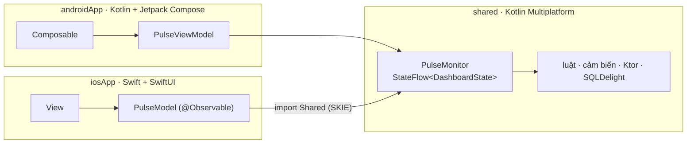

# Lộ trình: học Kotlin Multiplatform qua app Device Pulse

Lộ trình này đi theo mục lục [docs Kotlin Multiplatform](https://kotlinlang.org/docs/multiplatform/get-started.html)
(Get started → Create KMP apps → Project structure → Share code → iOS integration → Test → Publish),
nhưng sắp lại thành 14 bài **làm tay**. Mỗi bài thêm một mảnh vào cùng một app: [Device Pulse](project/index.md), app đo pin, GPS và mạng.

## Bạn sẽ có gì ở cuối

- Một app chạy thật trên **Android và iOS**: phần lõi (model, luật, cảm biến, mạng, lưu trữ, state màn hình) viết **một lần**
  bằng Kotlin trong `shared/`, còn **UI viết riêng**: Android bằng **Kotlin + Jetpack Compose**, iOS bằng **Swift + SwiftUI**.
- Hiểu vì sao code nằm ở `commonMain`, `androidMain` hay `iosMain`, và cách gọi API riêng của từng máy (pin, GPS, mạng).
- Biết nối Swift với Kotlin (`import Shared`, SKIE, đọc `StateFlow` từ SwiftUI), xin quyền, gọi mạng, lưu dữ liệu offline,
  viết test và build bản phát hành.

!!! info "Vì sao UI viết riêng (đổi 2026-10-21)"
    Bản đầu của lộ trình dùng Compose Multiplatform: một UI Kotlin vẽ cho cả hai. Nay đổi sang **KMP core + UI native**,
    giống code mẫu [`apps/DevicePulse/`](project/source-code.md) và mọi app trong repo: mỗi nền tảng có giao diện, điều hướng,
    xin quyền đúng chất của nó; logic vẫn chỉ viết một lần. Cái giá: màn hình viết 2 lần, và phải học thêm một ít Swift.

## Bốn chặng

| Chặng | Bài | Kết quả trên app |
|---|---|---|
| **A. Nền** | [1](lessons/01-what-is-kmp.md) · [2](lessons/02-setup.md) · [3](lessons/03-project-structure.md) · [4](lessons/04-share-code.md) · [5](lessons/05-dependencies.md) | Project `shared` + `androidApp` + `iosApp` chạy 2 nền tảng; có model, luật đánh giá, Koin, log |
| **B. Giao diện native** | [6](lessons/06-compose-basics.md) · [7](lessons/07-resources.md) · [8](lessons/08-viewmodel-navigation.md) | Dashboard 3 thẻ vẽ **2 lần** (Jetpack Compose · SwiftUI) trên cùng một state chung, tiếng Việt / Anh, màn Chi tiết + Lịch sử |
| **C. Cảm biến thật** | [9](lessons/09-battery.md) · [10](lessons/10-location.md) · [11](lessons/11-network.md) · [12](lessons/12-history-sqldelight.md) | Pin, GPS, mạng + độ trễ đọc thật; lưu lịch sử offline |
| **D. Ra mắt** | [13](lessons/13-testing.md) · [14](lessons/14-build-publish.md) | Có test, build AAB / iOS, crash report, CI GitHub Actions |

## Nhịp học gợi ý

- **1 bài / 1–2 buổi tối.** Đọc phần khái niệm 15 phút, còn lại để code.
- Chặng C nên thử trên **máy thật**: pin trên iOS Simulator không đo được.
- Xong chặng nào, đánh dấu ở [checklist](project/checklist.md).
- Kẹt quá 30 phút: xem [lỗi hay gặp](reference/troubleshooting.md), rồi mới đọc docs gốc.

## Cần gì trước

- Máy **Mac** (bắt buộc để build iOS). Không có Mac vẫn học được phần Android.
- Biết Kotlin cơ bản: `val/var`, data class, lambda, coroutine ở mức `suspend` + `launch`. Chưa biết thì đi
  [Kotlin tour](https://kotlinlang.org/docs/kotlin-tour-welcome.html) trước (xem thêm [tài nguyên học](reference/learning-resources.md)).
- **Swift cơ bản** cho phần UI iOS: `struct`, `enum`, optional `?`, closure, `View` / `@State` của SwiftUI. Biết Jetpack
  Compose thì SwiftUI quen rất nhanh (cùng kiểu khai báo UI). Chưa biết thì đi [Swift tour](https://docs.swift.org/swift-book/documentation/the-swift-programming-language/guidedtour/)
  + [SwiftUI tutorials](https://developer.apple.com/tutorials/swiftui) khoảng 2–3 buổi trước chặng B.
- Code gọi API của máy (pin, GPS, mạng) vẫn viết bằng **Kotlin** trong `androidMain` / `iosMain`; Swift chỉ dùng cho màn hình.

## Tiếp theo?

- **Nhìn toàn cảnh trước:** [Sơ đồ lộ trình](roadmap-map.md): mỗi bài làm gì, xong khi nào, hay vấp ở đâu, kẹt thì mở trang nào.
- Đọc qua [dự án Device Pulse](project/index.md) để biết đích đến.
- Bắt đầu [bài 1: KMP là gì, khi nào dùng](lessons/01-what-is-kmp.md).
- Muốn biết KMP được và mất gì trước khi học: [Đánh giá & kế hoạch](plan/kmp-review.md).
- Xong 14 bài: luyện tiếp [5 app từ dễ đến khó](apps/index.md), cùng khuôn với Device Pulse.
- Học sao cho nhớ lâu và có thực chiến: [Học bền & thực chiến](extend/practice.md).
